# 2.5D 收尾：去掉 Phaser

2026-10-16 至 17。分支 `feat/2-5d-closeout`，起点 main `1764874`。接着 [行动默认走 2.5D](../2-5d-default/README.md)（#57）当时列出的“还没做的”：旧行动改由 2.5D 收尾、约 20 个旧局内测试迁到 2.5D、标题页和结算页换掉 Phaser。

## 玩家看到的变化

- 存档里还没打完的旧行动——已关闭的沿海封锁区（含更早的 `coast-v1` 存档）和商场一版——从标题页「继续」后也在 2.5D 画面上打完，和新行动一样暂停恢复、结算。
- 标题页画面不变：同一套分层画、视差、雨、灯、船和水面，改由 PixiJS 绘制（与旧版逐像素对比，1280×720 下只有 0.16% 的像素有差别，最大 36/255，在半透明水面）。页签界面和结算页背景是同一张站外画。
- 单文件从 6.87 MB 降到 5.35 MB（7,205,295 → 5,605,866 字节），便携 ZIP 从 3.72 MB 降到 3.36 MB（3,897,948 → 3,524,929 字节）。
- 2.5D 行动补上旧画面原有、新画面缺的几处：
  - 上下楼后要重新按住移动键（不会带着按键冲进新楼层）；
  - 楼梯落点被堵时提示「入口被挡住，暂时无法进入。」，关门时门口有人提示「门口有人，暂时不能关门。」（以前显示英文原始码）；
  - 手机上点搜刮列表里的名称，直接打开那一个箱子或尸体（以前只是选中，按钮仍打开最近的）；
  - 搜刮时按 M 直接打开地图；
  - 手机多了「暂停」按钮；竖着拿手机时暂停并提示横过来，转回横屏后可继续；
  - 暂停面板有「行动指南」和「导出备份」；
  - 移动物品时有「旋转预览」「取消移动」按钮（手机没有 R 和 Esc）；
  - 右键精瞄时按左键也能开火；
  - 存档被另一个窗口更新后，结算面板只留「导出备份」，不再显示无法成功的「重试保存」；
  - 手机按钮至少 48 像素高，手机上不显示 Q 键提示；
  - 搜刮面板按 [搜刮说明](../LOOTING.md)：电脑上自己的背包、安全箱在左，来源在右；手机来源在前；
  - 搜刮窗口里一直显示生命、封锁倒计时和身体状态，被打时显示「正在遭受攻击！」，窗口不关；
  - 连续拿到同样的东西，提示合并成「× 2」「× 3」；
  - 可选来源的列表只在内容变化时重画，手机上点得中；
  - 触屏电脑上动鼠标或滚轮，回到键鼠操作；行动指南里按 Esc 回到暂停面板；拖动物品时按 R 原地旋转预览；
  - 手机：画面上的文字和按钮避开刘海和圆角，跟着世界位置走的提示（交互提示、楼梯名、撤离箭头、受击方向）在刘海屏上也对得准；矮屏上提示移到触屏按钮上方，不挡状态卡；任务列表能滚动；背包里物品的操作按钮不用滚动就看得到；竖着拿手机暂停时触屏按钮隐藏；电台台词落在状态卡和任务卡之间，不压在展开的任务上；
  - 竖屏暂停只看手机布局：触屏电脑把窗口拉成竖长不再误暂停；手机上输入拆分数量弹出键盘时不算转屏；
  - 门口的引导标记在敌人或子弹经过时让开，不再盖住门口的敌人腿部和飞过的子弹；
  - 负重的数字和「kg」不再被拆到两行；页签上的「行动指南」改成 2.5D 的操作说明（半屏拖动，没有「附近」按钮）。
- 存档相关的两处修正：
  - 旧封锁区行动里因流血或污染掉血而死时，生命会落到略低于 0，结算写入被存档校验拒绝（提示“建筑、角色或基地存档损坏或版本不兼容”）。现在掉血停在 0，和被打中一样。旧行动改走 Runtime 后玩家会遇到，自动游玩机器人发现的；
  - 行动中「导出备份」导出的是当前局面（Runtime 自己的快照），不再是上一次写入的检查点。

| 画面 | 截图 |
| --- | --- |
| 标题页（PixiJS），1280×720 | 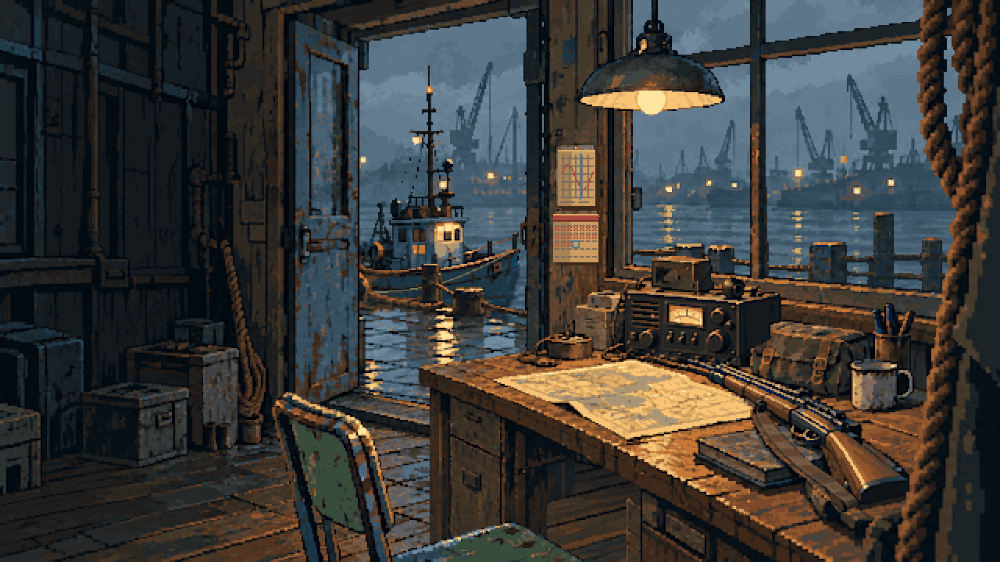 |
| 页签界面背景 | 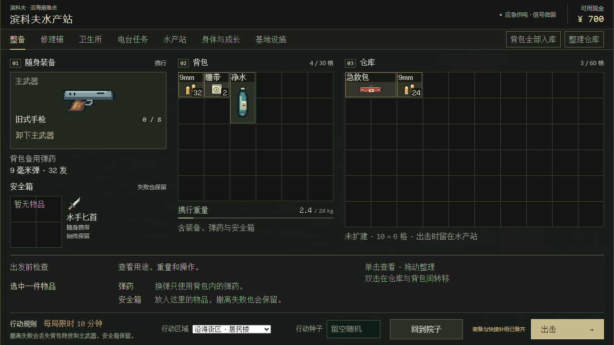 |
| 旧封锁区行动在 2.5D 上恢复（暂停中） | 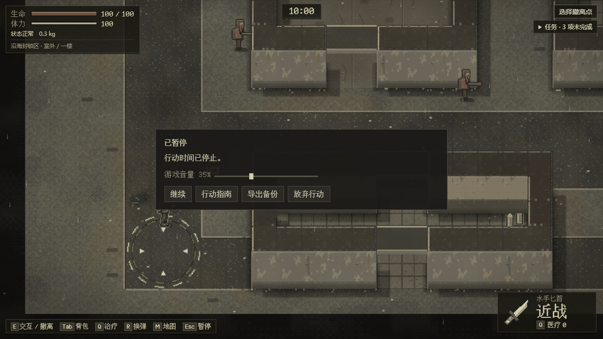 |
| 商场一版行动在 2.5D 上恢复 | 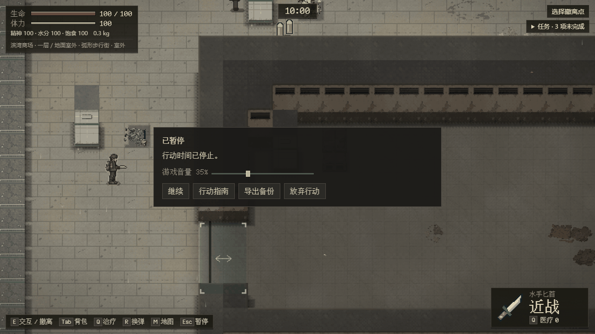 |
| 暂停里的行动指南 | 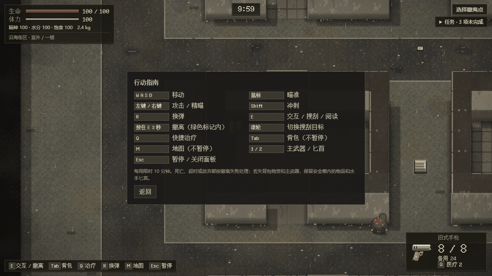 |
| 移动物品时的「取消移动」 | 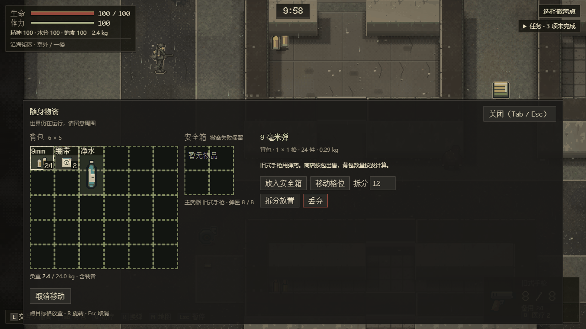 |
| 搜刮面板：背包、安全箱在左，箱子在右 | 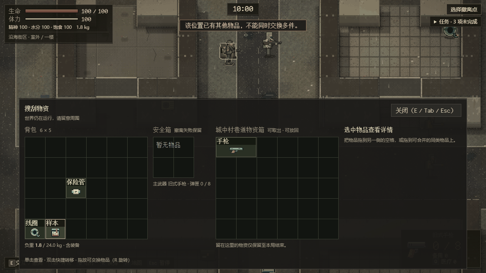 |
| 手机 844×390：触屏按钮里的「暂停」 | 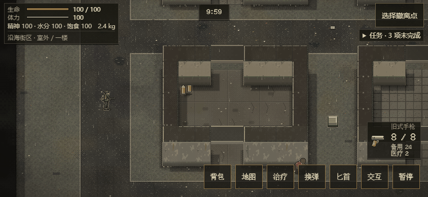 |
| 手机竖屏：暂停并提示横过来 | 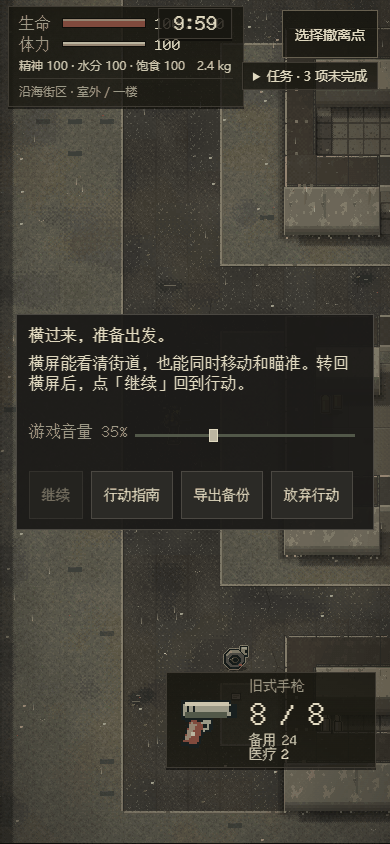 |
| 手机 740×300：电台台词在两张卡片之间，任务展开 | 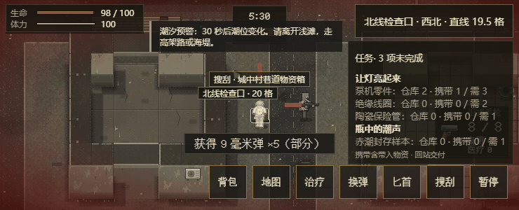 |
| 手机 932×430，模拟刘海（左 44、右 12、下 20）：HUD 在安全区内，提示对准物品 | 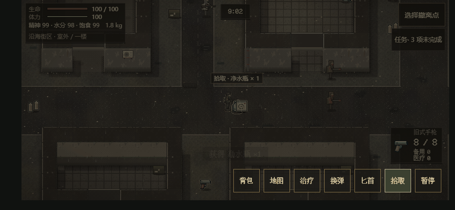 |

## 技术变化

- 依赖：去掉 `phaser`；第三方声明同步删除。`src/game.ts`（`RaidScene` 等场景）、`src/base-scene.ts`（旧走动据点）、`src/art.ts`、`src/mobile.ts`（旧触屏按钮）、`src/space-guide.ts`（旧门/楼梯指引）及只供它们用的绘制模块删除。
- 标题：[title/scene.ts](../../src/title/scene.ts) 在自己的 Pixi 渲染器上搭场景，规则与快照字段沿用；PNG 只在 [title/art.ts](../../src/title/art.ts) 导入（Node 单测引用 UI 时不加载图片）。[screen.ts](../../src/screen.ts) 按状态挂标题画面或站外画。
- 行动：[coast-view/sample.ts](../../src/coast-view/sample.ts) 的 `sampleSupports` 接受存档里的任何行动；`?test=1` 不带 `sample` 的旧测试夹具（Phaser 局内、商场一版）删除，`?test=1` 页面仍可出击已关闭的封锁区，用来制造旧行动。
- 旧页签界面 `ui.ts` 去掉只服务 Phaser 局内的 HUD、背包、搜刮、附近、地图、暂停/放弃面板和旧据点 HUD（985 → 约 700 行）；物品图和商人头像直接用原有绘制函数画。约 23 KB 只服务这些界面的样式一并删除。
- 测试夹具（只在 `?test=1`）：[test-support.ts](../../src/raid-runtime/test-support.ts) 新增 `magazine`、`vitals`、`clock`、`spawnLoot`、`container`、`hurt`，都经 Runtime 自己的快照/恢复或伤害路径；`clock` 按时间设置预警和潮汐标记，写出的检查点能通过严格校验。
- Runtime：旧封锁区的流血/污染掉血在 0 截止（[runtime.ts](../../src/raid-runtime/runtime.ts)），单测 `loot-recovery.test.ts` 覆盖流血致死后只结算一次。
- 2.5D 宿主：HUD 在安全区内，按视口坐标定位的标记从视口左上角起算（`--cs-ox`/`--cs-oy`）；门口引导在敌人身体、武器、影子或子弹轨迹压上它的那几帧隐藏（[scene.ts](../../src/coast-view/scene.ts) `updateStructureGuides`）；电台台词由宿主放在状态卡和任务卡之间（`placeRadio`）。

## 测试迁移

原来在 Phaser 局内画面上跑的浏览器测试都改到 2.5D 画面上，检查的行为不变；只有检查 Phaser 本身（场景、精灵、输入管理器）的步骤随它退役。测试夹具都只在 `?test=1` 下存在。

| 套件 | 现在怎么测 | 退役或换掉的检查 |
| --- | --- | --- |
| browser（主验收） | 默认区域沿海街区三张图；物资按种子自己的生成器逐件核对数量（箱子会合并重复堆叠，不再数 60 堆）；死亡、超时、潮汐用夹具设生命和时钟 | Phaser 场景列表，改查只有一个 2.5D 画面、没有旧画布 |
| loot | 默认区域；箱子夹具走存档事务；AI 继续运行看敌人计时；存储事件时只停 Pixi 计时器；双击拾取仍按物品编号核对 | 暂停 Phaser 场景 |
| save-browser | 背包转安全箱失败、撤离结算写入失败、跨窗口冲突，都在 2.5D 面板上 | Phaser 场景检查，改查没有行动画面 |
| expansion（最后一步） | 旧封锁区行动在 2.5D 暂停面板放弃，导出待保存的结算并重试一次；其余步骤照旧用真实旧客户端 | — |
| mall-landing、mall-passages | 商场布局三版；落点被堵时等 Runtime 拒绝和提示；换层只发一次楼层事件；敌人用夹具冻结 | 只记录不断言的屋顶签名；落地后按住鼠标不开火（鼠标按住本来就不连发，检查不会失败；Runtime 层由单测 mall-runtime G-07、S-04 覆盖） |
| tactical | 搜刮面板布局、实时时钟、按虚影角拖出拖回 | — |
| qol | 预览、旋转（按 R 立即重画）、拆分、放置取消、换弹、出口方位、任务、受击方向；先触发一条电台台词，再查它和导航卡不重叠 | — |
| qol-expansion | 药品车离开提示改在页签界面（走动据点已删）；商场布局三版的重叠箱子、滚轮与 E、触屏点名称、拆分旋转后刷新、搜刮时被打 | 走动据点 |
| loot-target | 重叠来源的选择列表、滚轮与 E、触屏点名称、范围、隔墙、潮汐和撤离优先；搜刮窗口的危险提示 | 「附近」逐件拾取是 Runtime 缺口：守卫断言现在的行为（E 打开箱子、旁边的物资留在地上），补上后测试变红，提醒恢复原断言 |
| buildings | 门写入失败与重试、上下楼松开按键、刷新、追击开门、室内警告、超时结算失败后重试 | — |
| systems | 走动据点改在水产站院子；商场布局三版的故障注入、连通道往返和四种结局 | 每条连通道在浏览器里只真实往返一次（原来十次，十次往返由单测 mall-runtime G-06 覆盖） |
| ui | 出击、状态、背包、地图、暂停、放弃 | 「生命已满」说明是 Runtime 缺口：守卫断言现在的通用提示，补上后测试变红 |
| hud-release | 结算后 HUD 能回收；第二局改为旧封锁区行动，同样在 2.5D 上用真键鼠 | Phaser 输入管理器检查 |
| desktop-input | 移动、右键加左键开火、触屏笔记本、暂停与音频、无效治疗（同上，守卫）、写入失败重试 | — |
| art | 物品图和商人头像由游戏自己的绘制函数画出，并与页面像素比对；角色、尸体、箱子状态读 2.5D 纹理；用面板按钮搬空一个箱子，空箱外观在存档和刷新后保持 | Phaser 精灵检查（世界纹理、朝向排列、分层同步）；尸体在 CI 动画组 V03/V04，房间揭示在 issue26-spatial S05 |
| mobile | 双摇杆、竖屏暂停、暂停按钮、拾取后刷新、导出备份、写入失败回滚、按钮尺寸；子弹飞行中写检查点，刷新后恢复的行动与存档完全一致 | — |
| mobile-ux | 七种手机尺寸的背包和详情出口、取消移动、提示不挡任何 HUD、连续拾取「× 2」、阅读、换弹；刘海安全区用 DevTools 安全区模拟（`env()`）查三种尺寸 | 手动设的 `--safe-*` 内边距（2.5D 用 `env()`）；「附近」列表是 Runtime 缺口 |
| issue26-inventory | 只留村庄入口，同样七个用例 | 旧封锁区的 Phaser 入口 |
| issue26-phaser-spatial | 整套退役，其中两项移到 issue26-spatial：S03b 门口引导不盖住门口的敌人和子弹（原 P08，2.5D 上改为让开），S03c 楼梯名不盖住敌人（原 P09，见剩余工作）；其余只查 Phaser 的画法 | Phaser 画法 |
| coast-sample | 新增 `test:coast-sample` 跑完整 53 步，本地通过；CI batch-7 仍只跑动画组（CI 的软件渲染下，V-CAM 之后再开页面会超时，完整套件进 CI 前要先把 V-CAM 挪到最后） | — |
| raid-default | R5、R6：旧封锁区和商场一版行动从标题页继续，在 2.5D 上打完 | — |
| mall-sample M10、coast-sample W16、station、hideout、sol-sample-boundaries | 改成 2.5D 上的断言，或去掉 Phaser 步骤 | Phaser 步骤 |
| title、title-water 等标题脚本 | 读新的 Pixi 标题钩子 | — |

删除的脚本：`runtime-differential`（RaidScene 与 Runtime 对照）、`art-performance`（Phaser 帧率对比）、`sol-r6-original-audio`（原版音效探针），对象都已不存在。截图脚本 `preview` 和两个自动游玩脚本 `natural-play`、`layered-play` 改到 2.5D。单测：`space-guide.test` 随代码删除，`save-flow.test` 改写，新增 `coast-v1` 行动在 Runtime 上恢复并只结算一次。

## 验证

本地 Windows 10、Node 24、Playwright 自带 Chromium，全部离线：

- `pnpm test` 452/452；CI 规则测试（`scripts/ci/*.test.mjs`）38/38；`pnpm package` 通过。
- 评审修正全部合入后，在最终构建上把 CI 的 36 条浏览器命令全部跑了一遍（本地三路并行），全部通过；此前每轮修改后也重跑过受影响的套件。
- 两轮评审（产品代码、测试迁移）提出的问题都已处理：上面“玩家看到的变化”里刘海、竖屏暂停、备份、门口引导、电台、负重几项，以及测试里的守卫、计时等待和恢复的检查。
- 自动游玩：`test:layered-play` 商场三局（超时、死亡、撤离）通过；`test:play` 在旧封锁区两次碰到结算被拒，查出上面的流血致死问题，修正后单测固定住。
- 迁移时 browser、loot、save-browser、expansion、mall-landing、mall-passages（7 条通道 × 走和跑，各往返 10 次）以及 ui、hud-release、desktop-input、art、mobile、mobile-ux 各连续通过两次；loot 的旧主线可选步骤（`BINCOV_LOOT_LEGACY_HTML`）和 expansion 的真实旧客户端（07b1414）也跑过。
- 标题页：Pixi 版与 Phaser 版逐像素对比，1280×720 下 0.16% 像素有差别，最大 36/255。
- 手机背包在 667×375、640×300、844×390 下实测：详情栏与背包、安全箱并排，前三个操作按钮不用滚动可见（640×300 下最后两个按钮需要滚动面板）。

CI 第一轮（没有显卡、用软件渲染的 Linux）有 7 组失败，都不是游戏逻辑问题：那里 2.5D 每帧要 0.2–0.5 秒，迁移过来的测试有几处按快机器写的时序。主要原因是行动刚开始、换层或刷新后的头几帧间隔超过 2 秒，Runtime 的卡顿保护（画面停顿超过 2 秒就暂停行动）会暂停行动，后面的按键、点击和挂上的存储故障都对不上。改法：
- 套件装上 [stall-resume.mjs](../../scripts/stall-resume.mjs)，只在 Runtime 发出“画面暂时停顿”时点「继续」，其他暂停仍算失败；
- 按键改为按到确实生效为止；
- 等待改为等已发布的状态或游戏时间，不用固定毫秒；
- 存储故障挂在按下那一下上，避免被每 2 秒的检查点先吃掉。
本地复现办法：把测试进程（及它启动的 Chrome）固定在 1–2 个 CPU 上，并用 `BINCOV_CHROME_ARGS=["--use-angle=swiftshader","--enable-unsafe-swiftshader"]` 走软件渲染。

没有验证：真机（刘海安全区用 Chromium 的模拟查过，真机外形以实测为准）；CI 的 Linux 软件渲染以本 PR 的检查结果为准。

## 剩余工作

2026-10-22 现状：下面 Astra 的第 1、2、3、6 项及对应前端接入由 [PR #65](https://github.com/xuys2025/escape-bincov/pull/65) 补齐（[实施记录](../tasks/runtime-gaps.md)），上文 loot-target、mobile-ux 的缺口守卫已改为正式验收；第 6 项没有在真实的无 GPU 设备上验证。以下保留 #64 当时的原文。

需要 Astra（Runtime 规则、存档事务、复验）：

1. 治疗被拒时说明原因：满血按 Q 旧画面提示“生命已满…”，2.5D 只有通用提示——Runtime 拒绝事务时把这条说明连同其他事件一起丢掉了。
2. 「附近」逐件拾取：[搜刮说明](../LOOTING.md)要求地面物资与箱子重叠时可逐件拾取；现在电脑上范围内有箱子时 E 总是打开箱子，旁边的地面物资拿不到，服务里也没有按编号拾取。
3. 对本 PR 做独立复验（旧行动恢复与结算、存档失败与冲突、新测试夹具），包括 Runtime 里流血掉血在 0 截止这一处改动。
4. 商场布局四版的并存与复验（#47，见下）。
5. 新的沿海封锁区地图数据（等维护者定方向）。
6. 慢设备开局卡顿暂停：没有显卡的设备上，行动开始或换层时首次生成贴图要几秒，[ActiveClock](../../src/input.ts) 把这段算进帧间隔，超过 2 秒就自动暂停，玩家每局开始可能要按一次「继续」。需要 Runtime 提供重新对时的办法，宿主在挂载和重建后调用。

需要 Sol（美术）：

1. 四种敌人和尸体的 2.5D 角色图（现在是程序画的剪影，与主角风格不一致），以及主角的手枪、霰弹枪、匕首持握图。
2. 沿海街区其余约四分之三：水产市场、潮汐观测站、旧渔港、海堤泵房和共用的岸线、混凝土、木板等（[美术设计](../COAST-2_5D-ART-DESIGN.md) §4.2）。
3. 滨湾商场其余 31 个区域（#47，布局四版之后）。
4. 新封锁区的美术（地图定了以后）。

前端还留着的一项（Opus）：楼梯名是网页文字，敌人正好站在它下面时会被盖住一部分（issue26-spatial S03c 已登记为缺口）。让楼梯名在敌人附近隐藏会让人在交火时看不到去向，画到画布里又会糊；需要定一个做法再改。

需要维护者决定：新封锁区做成什么地图；美术先做哪一批（建议先做敌人和尸体，每局都看得到）。
