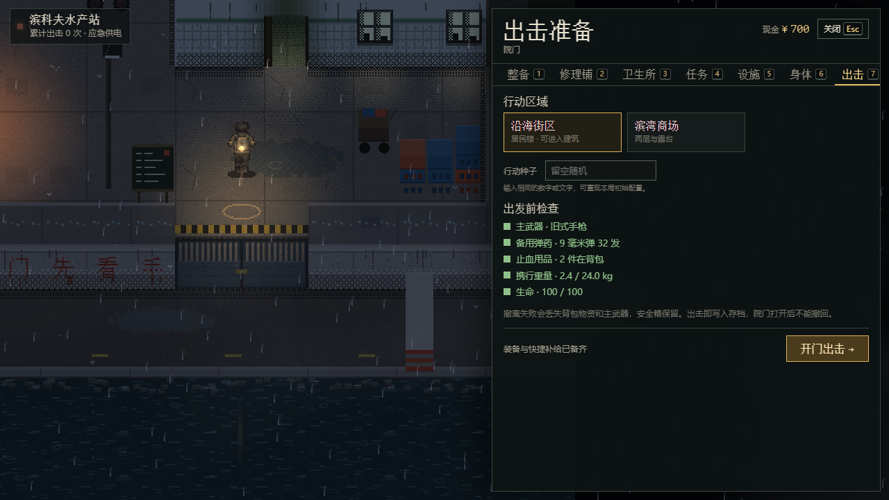
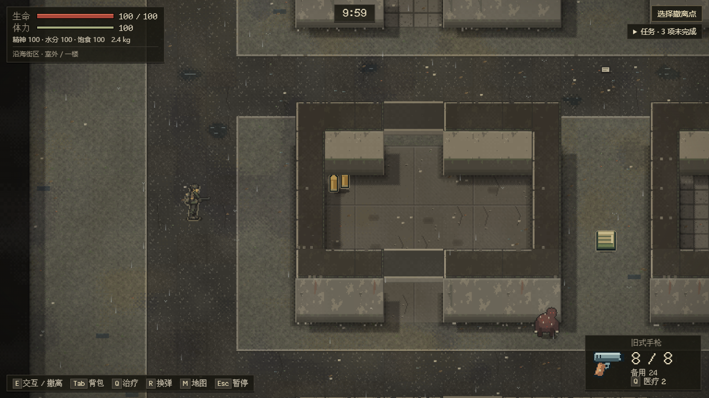
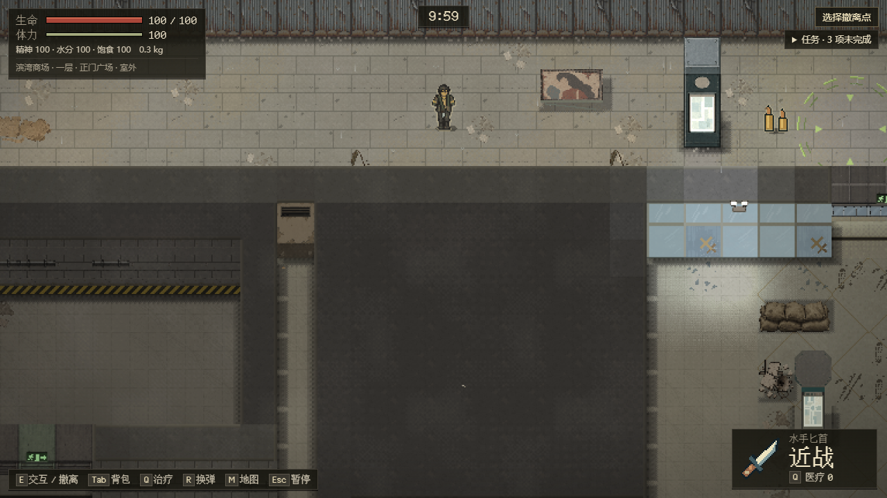
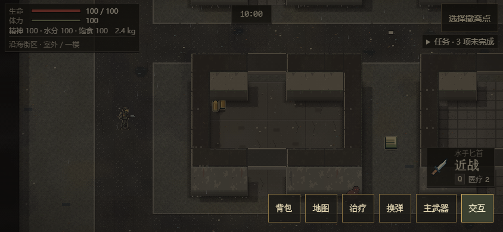
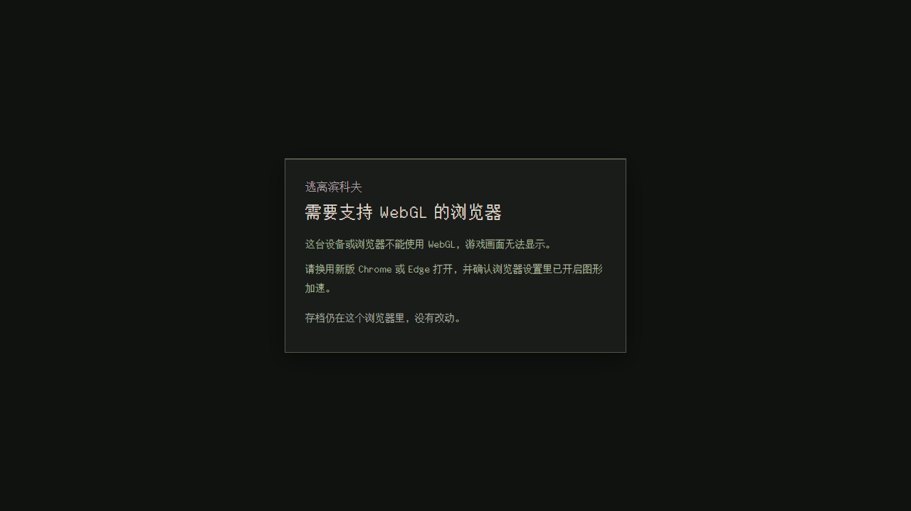
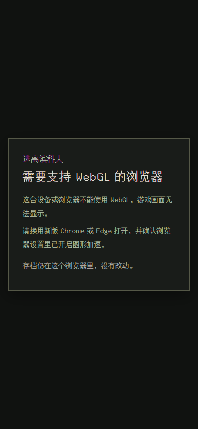

# 行动默认走 2.5D

2026-10-15。分支 `feat/2-5d-default`，起点 main `50a05aa`。决定与范围见[任务清单](../WORK-QUEUE.md)当天条目。

## 玩家看到的变化

- 出击面板只有两个区域：**沿海街区**（默认）和**滨湾商场**。沿海封锁区和街区是同一张地图，已关闭，以后作为新地图重做。
- 两个区域的行动都在 2.5D 画面上进行。商场新出击用布局三版。
- 之前开始、还没打完的封锁区行动和商场一版行动，从标题页「继续」，仍在原来的画面上打完。
- 浏览器不支持 WebGL 时，只显示提示，不进入游戏，也不读写存档。
- 普通入口不再画样板标记（没精修的地方压暗、左上角「样板外」）。`?sample=village`、`?sample=mall` 仍保留这些标记，方便看美术进度。
- 手机上的 2.5D 行动多了「切换武器」按钮，按钮上写的是要换成的武器。

美术还没补齐：街口以外的街区用通用画面，商场只布置了正门广场到露台一段。

## 截图

均来自 `pnpm test:raid-default`（离线打包文件，普通入口，Chromium）。

| 画面 | 截图 |
| --- | --- |
| 院子出击面板，1280×720 |  |
| 沿海街区，种子 42，出生在街口精修区以外，1280×720 |  |
| 滨湾商场，布局三版，1280×720 |  |
| 手机 844×390 触屏，切到匕首后 |  |
| 没有 WebGL，1280×720 |  |
| 没有 WebGL，390×844 |  |

## 测试夹具

`?test=1` 不带 `sample` 时保持旧行为：Phaser 局内画面、三个区域（默认封锁区）、商场一版。约 20 个旧局内浏览器测试靠它继续运行，不用改。带 `sample=` 的样板测试和普通入口走新路由；只要带 `test=1`，出击面板仍提供封锁区，测试可以在同一页面先打 2.5D、再打旧画面（`test:hud-release`）。以后去掉 Phaser 时，这些测试要迁到 2.5D 画面上。
