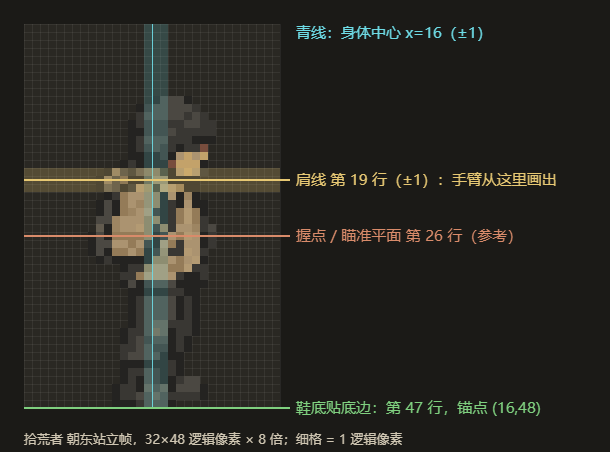

# 受击姿态美术需求（#75 打击感）

草稿，交给 GPT 绘制。本目录只有需求、模板和参考图；游戏还没有接入，接入另开代码 PR。

## 为什么要画

现在敌人中弹时身体贴图不变，只有 70 ms 闪白，以及 80 ms 内顺着子弹后退 2 像素（#88、#94）。[#75](https://github.com/xuys2025/escape-bincov/issues/75) 研究的 P1 建议：程序表现做完后，为少量敌人补“受击 / 恢复”关键姿态，让中弹有身体反应。

## 和 #81 的分工

[#81](https://github.com/xuys2025/escape-bincov/pull/81)（街区敌人，草稿，进行中）负责十八类原型的身体、步态、尸体和攻击动作。它的攻击动作用程序形变；中弹时，闪白轮廓只跟着身体一起缩放和倾斜，没有受击帧。

本需求只补受击和恢复两帧，不碰攻击动作、尸体和倒地。B 组的参考帧取自 #81 分支 `2fcad9d`，接入要等 #81 合并。#81 如果改了这三类的身体，就按新图重做模板，可用 [sources.json](../../assets/hit-feel/templates/sources.json) 里的哈希核对。

## 范围

| 组 | 角色 | id | 逻辑尺寸 | 模板 |
| --- | --- | --- | --- | --- |
| A | 拾荒者 | `scav` | 32×48 | [scav](../../assets/hit-feel/templates/scav-hurt-template-v1.png) |
| A | 盐枭 | `salt` | 32×48 | [salt](../../assets/hit-feel/templates/salt-hurt-template-v1.png) |
| A | 守潮人 | `elite` | 32×48 | [elite](../../assets/hit-feel/templates/elite-hurt-template-v1.png) |
| A | 潮蚀生物 | `creature` | 40×28 | [creature](../../assets/hit-feel/templates/creature-hurt-template-v1.png) |
| B | 近身掠夺者（#81） | `raider-melee` | 32×48 | [raider-melee](../../assets/hit-feel/templates/raider-melee-hurt-template-v1.png) |
| B | 拾荒枪手（#81） | `raider-gunner` | 32×48 | [raider-gunner](../../assets/hit-feel/templates/raider-gunner-hurt-template-v1.png) |
| B | 望风者（#81） | `raider-lookout` | 32×48 | [raider-lookout](../../assets/hit-feel/templates/raider-lookout-hurt-template-v1.png) |

A 组是 main 现有的四种敌人；B 组是 #81 已正式投放到街区的三类。以下不在本批：主角；#81 其余十五类（正式投放后再补）；倒地过渡帧；攻击动作图集。

## 每个角色交一张图集

- 3 列 × 5 行的透明 PNG。行从上到下是 E、SE、S、NE、N；朝西的三个方向由游戏镜像，不用画。
- 第 0 列是现有站立帧，模板里已经放好，原样保留；第 1 列画受击，第 2 列画恢复。
- 每格是逻辑像素放大 8 倍（最近邻）：人形每格 256×384（32×48），整张 768×1920；潮蚀生物每格 320×224（40×28），整张 960×1120。
- 直接在模板上编辑：`assets/hit-feel/templates/<id>-hurt-template-v1.png`。

## 姿势

**受击（第 1 列）**：中弹后一瞬间的身体反应。

- 缩肩、低头 1–2 个逻辑像素、躯干收紧、膝盖微屈。
- 不要明显前倾或后仰。子弹可能从任何方向打来，方向感由游戏里的 2 像素后退提供。
- 兜帽、衣摆、背包、挎带可以甩动 1–2 像素，帮助在 32×48 下看出“挨打”。
- 守潮人穿重甲，反应可以更小更沉。

**恢复（第 2 列）**：介于受击和站立之间，大约回复一半。

**潮蚀生物**：壳和身体收缩下压，头和前肢缩到壳下，腿撑住地面。

在原尺寸（1 倍）下，受击帧的头部或肩部轮廓至少要和站立帧差 2 个逻辑像素，否则游戏里看不出来。

## 必须守住的位置

- **脚**：人形鞋底在第 47 行，锚点 (16,48)；潮蚀生物足底在第 27 行，锚点 (20,28)。整体最多下沉 1 像素，脚不能左右滑动。
- **肩**：人形肩线保持在站立帧的 ±1 像素内（第 19 行附近），身体中心保持在 x=16±1。游戏从肩点画手臂，一直伸到第 26 行的武器握点；肩点跑偏，手臂就会和身体脱节。
- **部件**：只画站立帧里已有的部分，即头、躯干、已有的袖子、背负物、骨盆、腿和鞋。不要新增前伸的手臂、手或武器。B 组的身体本来就不含肩以下的手臂。

## 风格

- 和第 0 列保持同一个角色、同一套配色、同样的 1 逻辑像素描边、同样的左上方柔光和像素颗粒。
- 在 32×48 下也要是清楚的大块形状。不要 Q 版，也不要平滑上色。
- 不画血、伤口、文字、地面、影子、动作线、特效、分隔线或标签。
- 背景必须是真透明，不能把棋盘格画进图里。

## 怎么生成，放在哪里

1. 用内置 `image_gen` 编辑对应模板，做法同 #81。起始提示词在 [prompts-draft.json](../../assets/hit-feel/prompts-draft.json)，可以按结果返修。
2. 生成的图如果带底色，再用其中的 `alphaCleanup` 去掉背景。
3. 输出存为 `assets/hit-feel/sources/<id>-hurt-sheet-v1.png`，返修依次存 v2、v3，旧版保留。实际用过的提示词逐字记入 `assets/hit-feel/sources/prompts-v1.json`。
4. 只提交到本 PR 的分支 `art/hit-feel-poses`。不要改 `src/`、现有运行图或素材清单。

## 接入前的检查（由 Claude 做）

- 尺寸、行列和透明背景正确；第 0 列缩回原尺寸后与现有站立帧一致。
- 第 1–2 列与第 0 列同比例；脚点、肩线和中心在上面规定的范围内，人物没有超出格子。
- 在 1 倍尺寸下，以及游戏内 1280×720 和 1920×1080 下，都看得出受击；和闪白、2 像素后退叠在一起不别扭。
- 不合格的格子返修，不靠擦除、裁切或逐帧居中来掩盖。

## 接入计划（后续代码 PR）

- **切帧**：按网格切开，每一行用第 0 列求出统一缩放和脚点（同 #81 的 `enemy-export-art`：一张图共用缩放，每个方向共用脚点），把第 1–2 列导出为运行帧，写入清单和哈希。
- **播放**：中弹时先放受击帧约 90 ms，再放恢复帧约 60 ms，然后回到原来的站立或走路帧；时长由试玩决定。闪白轮廓从同一帧生成。敌人走动时是否也播（播的话会有一瞬间滑步），接入时再定。
- **顺序**：A 组可以先接入；B 组等 #81 合并后接入，并和 #81 的 `enemyMotion` 形变叠加。

模板第 0 列的来源帧和 SHA-256 记在 [sources.json](../../assets/hit-feel/templates/sources.json)。模板、标注图和总览都是按这些帧放大 8 倍（总览为 4 倍）直接生成的，没有重画。
