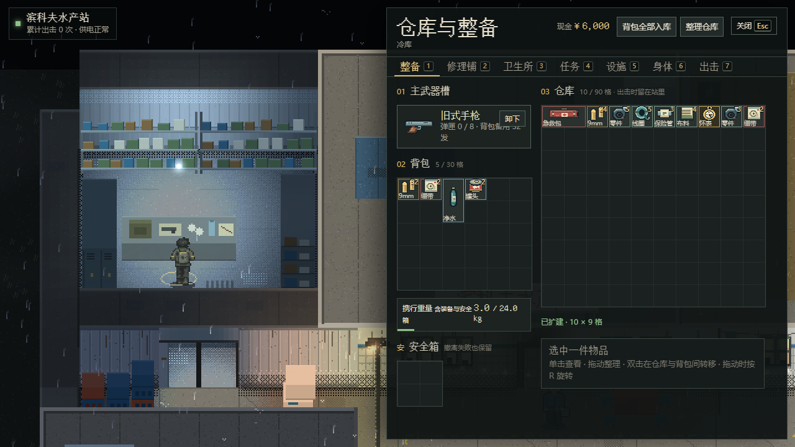
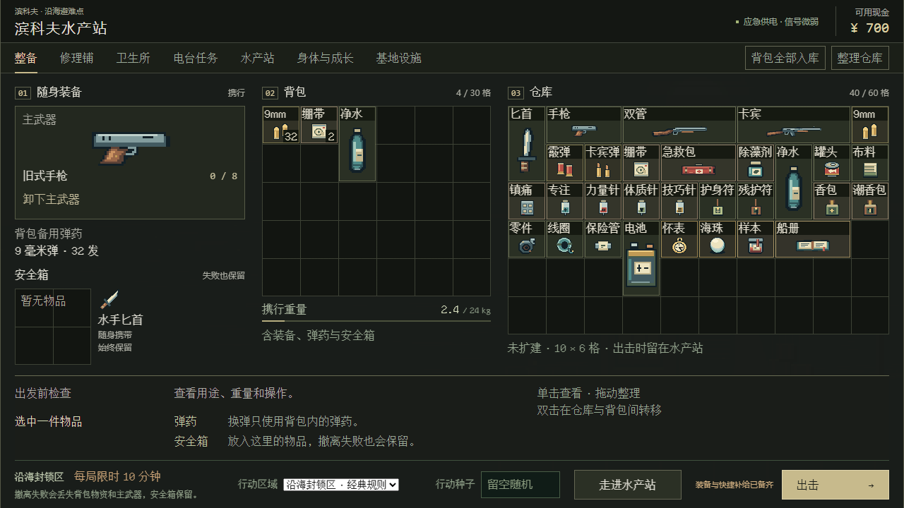
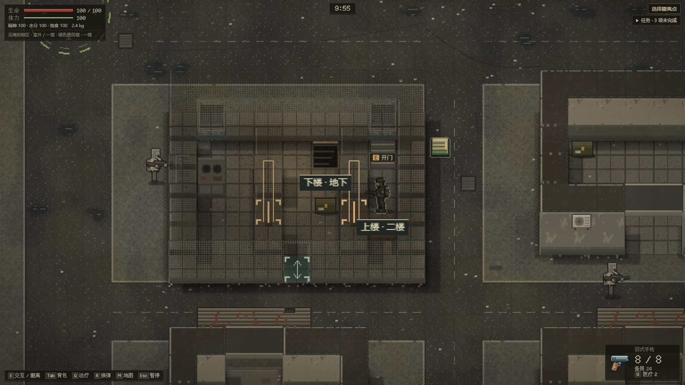
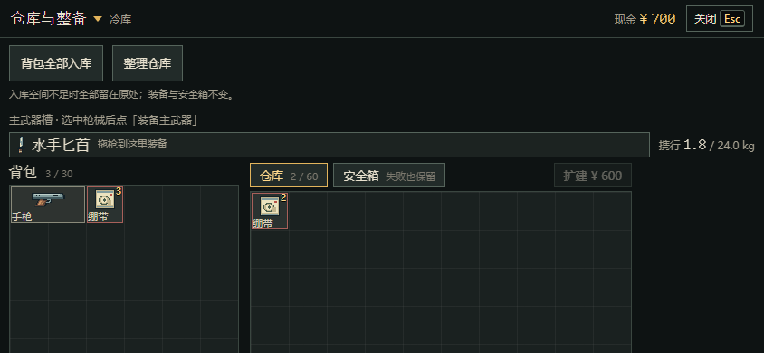
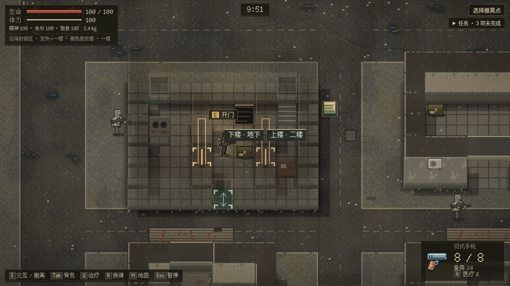
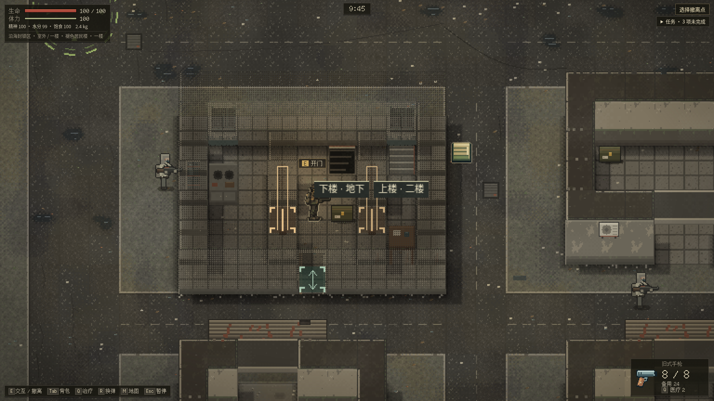
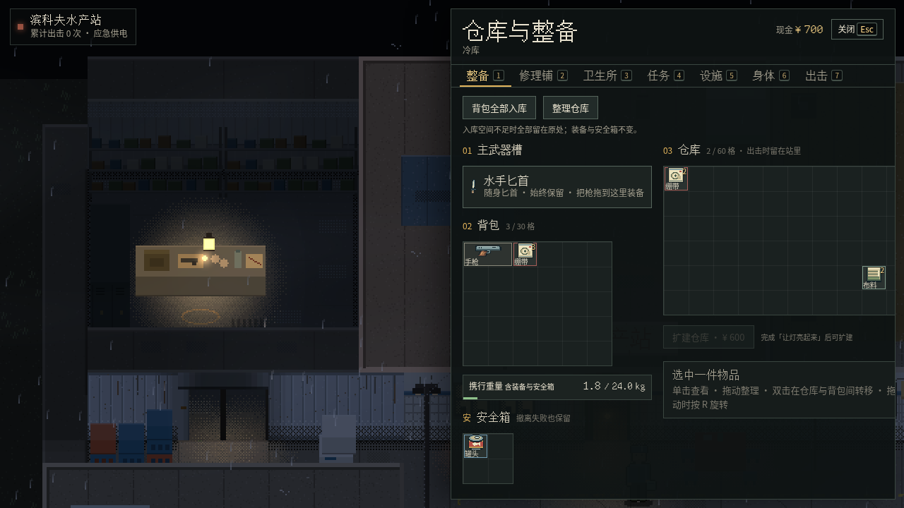

## 2026-10-13 最终核对补记：同步 #46

此前提交 2dfde47 / CI 38408465448 的完整CI已成功，issue已据此更新；最终核对发现并行#46刚合入main 7df2d22，因此继续原分支正常合并该主线。冲突仅为生成物和交接文档；保留双方历史，接入#46的13项商店输入检查，正式重新打包。同步后本地314/314 单测、严格TS、打包及[商店13/13](evidence/closeout/merge46-shop.json)通过。当前HTML SHA256为774d9ea4aefa4f683d7fc1f21f0eb33a2d2bca7eb5fa4b630fdbe80686af4c3d。同步后的准确head完整CI以原PR最新结果为准；本PR尚未合并或发布，原失败证据和未完成范围不变。

#44已采用同一输入时间戳实现，因此此次同步后HTML与上轮完整CI的游戏字节完全一致；新增变化为主线测试/文档及本补记。

# #26 玩家反馈：库存与室内辨识

## 2026-10-13 原 PR #44 收尾复验

本轮按维护者要求接续原分支，正常合入 main `95036af`，保留双方文档历史。原 head `f68b593` 的[首次CI](https://github.com/xuys2025/escape-bincov/actions/runs/38342617416)并未通过：传统整备安全箱被新工具栏挤入详情区，院子站内专项13/15（双击恢复及844×390全网格可见性），导致局内专项未开始。原始失败记录保留，以下为收尾结果；最终head完整CI以原PR为准。

本轮补齐：

- 传统整备桌面工具按钮移入页签行，恢复安全箱和详情的空间；两尺寸旧战术布局专项8项通过。窄屏院子仓库保留正常纵向滚动，专项检查首行和最后一行真实物品的视口边界与点击命中区域，不再要求6行网格同时挤进390像素高度。
- 院子双击按原生`PointerEvent.timeStamp`判断320ms窗口，避免首击重绘卡帧使已发生的第二击变成单选。测试去掉逐击80ms等待，保留原生事件时间，仅固定检查点所需的`Date.now`；记录可信输入、目标UID与实际间隔。400ms阻塞夹具在旧产品失败、修后通过；24倍CPU降速2/2通过，未提高双击阈值或加入失败重试。
- 城中村存档失败离开搜刮时清空旧`lootContext`；物品/世界/原存档字节一同回滚，保存恢复不重放拒绝的转移，玩家可重新打开容器再操作。原有Runtime原子性单测补此边界，双入口浏览器故障/重试通过。
- 多窗口用例先打开第二页，再持有真实交换预览，休眠Phaser渲染循环而非暂停Scene；暂停Scene会触发`isActive`守卫，使原测试无法建立可用搜刮。真实storage事件、写入锁、原始字节与双边物品断言均保留。
- 楼梯标签在接近时移到角色下方，避开角色头部与头顶交互提示；保留已知结构条件，隐藏内容权限不变。两尺寸各三个站位及门/楼梯/隐藏像素正反对照14/14通过。第一次新增夹具把角色放到墙内而失败，已改成原地图合法位置，未改碰撞规则。

本地环境为Windows、Node24.19.0、pnpm11.19.0、Chrome155.0.8059.40，真实离线包与键鼠/仿真触控。结果与各次构建哈希分别保存在报告内：

| 验证 | 实际结果与证据 |
| --- | --- |
| 单测、严格TS、打包 | [314/314](evidence/closeout/unit.log)、[打包通过](evidence/closeout/package.log)，HTML/ZIP/manifest重新生成 |
| 站内快捷、装备、批量和整理 | [16/16](evidence/closeout/station.json)，1280×720、1920×1080、390×844、844×390；含配额失败、刷新和数量/标记守恒 |
| 慢主线程双击 | [旧包有效失败](evidence/closeout/station-busy-old-product.json)、[24倍降速2/2](evidence/closeout/station-cpu24.json) |
| 双入口局内库存 | [20/20](evidence/closeout/inventory.json)，含真实交换、部分堆叠、配额回滚重试、第二窗口较新记录；原文22为计数误写，实际矩阵为20 |
| 室内结构与楼梯标签 | [14/14](evidence/closeout/spatial.json)，含隐藏内容零像素变化与强制泄露正对照 |
| 旧整备布局 | [8项通过](evidence/closeout/tactical.json)，两尺寸安全箱/详情及真实交易 |
| 共享院子输入回归 | [商店11/11](evidence/closeout/shop-feedback.json)、[一级10/10](evidence/closeout/station-tier1.json) |

局内库存20项报告针对存档/多窗口修复后的中间构建；之后仅改院子时间戳与楼梯标签，最终生成包的完整组合由CI执行。自然设备性能、真人观感与原#32未确认项仍未签收。

额外完整院子回归[75/76](evidence/closeout/station-full-first.json)，唯一失败是1280×720扩建仓库的“保险管”短名裁切；同机[main对照4/4](evidence/closeout/labels-main.json)通过，确认为本PR新工具栏挤小格子导致。最终将桌面院子工具按钮放到标题栏，格子至少36px，保留首次选择时几何稳定；[文字/面板高度/真实拖拽旋转双击6/6](evidence/closeout/gear-header.json)通过。只放大格子的中间方案引起29px滚动，该[中间失败](evidence/closeout/gear-labels-first.json)保留。修后站内16项再次完整验证；没有把上述分次结果拼成一轮76/76。

收尾CI `38405926739` 新增专项通过后，旧搜刮回归停在本PR新增的快捷拾取持久化比较：[首败](evidence/closeout/loot-ci-first-failure.json)。现场快照只摘录了id/runId/kind/inventory，而存档还含name/x/y，因此完整对象不相等；物品内容和位置没有丢失。现场快照补齐同一容器的name/x/y，保留整对象相等断言；修后[两桌面尺寸各21项、触屏4项，共46/46](evidence/closeout/loot-final.json)。未改产品事务或删减比较字段。本地未设置可选旧客户端HTML参数；CI既有真实旧客户端检查保持。

并行PR #46也将共享GridDrag改为原生输入时间；本PR相同行为与注释保持一致，商店专用连续触控脚本仍由#46承接，未覆盖其工作树或issue状态。









以下保留原提交的交付快照与首败，旧“待复验”以本节及原PR最新CI状态为准。

---

基线为 `origin/main` `3f706b77e9b924b0cee085e79c54479a0c19da65`，分支 `fix/issue26-player-feedback`。本批没有同目标开放 PR；射击、改枪及剧情在途 PR 保持原归属。

维护者最初授权独立开发、自验并经 PR 合并，后续要求因额度限制尽快收尾、提交 PR 并将剩余情况写入 #26。因此本次按**草稿、待最终验收**交付，不把尚未跑完的验证记为通过，也不提前合并。

## 已实现范围

| 项目 | 当前实现与边界 |
| --- | --- |
| F01 | 传统局内与城中村搜刮增加双击快捷转移；触屏保留显式按钮。兼容堆叠可部分转移，余量留来源；空间不足明确提示。基地原已有双击，补反馈及布局稳定性。 |
| F02 | 完整物品拖到唯一其他物品时，校验双方位置后交换；可尝试返源物品旋转。拆分不能交换，多件重叠拒绝；兼容堆叠仍优先合并，满堆及救济标记不符仍拒绝。 |
| F04 | 最新主线救济独立复验通过，无须重复实现。进站发放、幂等、失败重试与刷新、旧页签保持一致。满包排队另有原领域测试。 |
| F05 | 明确主武器槽、装备按钮与安全箱先回背包的路径；换枪回收空间不足给具体原因，避免通用提示覆盖；保存失败不显示成功。未改变装备来源规则。 |
| F07 / F11 | 城中村样板增加门开闭轮廓、通道箭头、楼梯目的地；进入建筑揭示当前层整体结构。人物、物资、尸体与血迹仍遵守原 `revealed` 权限。普通 Phaser 画面未重做。 |
| F09 | 背包全部入库一次提交，装备与安全箱保留。空间不足整批不动，存档失败回滚。 |
| F10 | 仓库同类同救济标记合堆，大件优先确定性排布并可旋转；无法排下则原样保留。没有锁定格位功能。 |

主档键、格式和既有存档版本不变；行动容器交换与玩家库存仍在同一检查点提交。没有新增运行时网络依赖。新增文字沿原固定字体来源重新生成子集，许可不变。

## 实际验证与证据

环境：Linux、Node 24.19.0、pnpm 11.19.0、Playwright Chromium 153.0.8010.12。浏览器使用离线打包 HTML；测试专用入口仅用于物品、摆位与存储故障夹具，交互发送真实键鼠/仿真触控。没有真机或真人验收。

- 最终 `pnpm test` **314/314**，0 失败（10.22 秒）。此前 313/313 与定向 65/65 为追加装备提示用例前后的中间记录，不替代最终结果。
- 最终 `pnpm package` **通过**，已重新生成 HTML、两 ZIP 与发布清单。见[最终检查记录](evidence/final-checks.json)。
- 原 main 救济专项 **6/6**：[原始报告](evidence/relief-baseline.json)。
- F07/F11 两尺寸专项 **12/12**：[原始报告及构建哈希](evidence/spatial-first.json)。包括真实开门穿过、上下楼、整层结构、出屋恢复，以及隐藏内容零像素变化和强制泄露正对照。此报告针对其中记录的构建，不能代替后续全部组合验收。
- 首版站内专项 **7/11**：[原始报告](evidence/station-first.json)。其中 UID 不变假设不符合原自动转移分配新 UID 的规则，测试已修为数量/标记守恒及成功写入次数；另发现选择详情使格位移动、右侧裁切，以及拒绝提示泛化。修复后仍需最终专项复验。首败截图保留，不能用后续通过覆盖此历史。
- 新增局内专项 22 项及修订后的站内专项、旧库存回归已接 CI；尚未完整本地运行通过。**完整 CI 与最后构建的浏览器组合检查仍是合并门槛。**







复验命令：

```bash
pnpm test
pnpm package
pnpm test:issue26-station
pnpm test:issue26-inventory
pnpm test:issue26-spatial
pnpm test:loot
pnpm test:save-browser
pnpm test:portable
```

三个新专项均支持 `--html=<旧包>`、`--out=<独立报告目录>`；原 main HTML 已在本地 `test-results/issue26-baseline/index.html` 留存。其余输入、UI、手机、存档、发布与世界回归依仓库 CI 完整运行。

## 保留问题

1. 最终站内布局/双击、局内 22 项及完整 CI 尚待验收；任何失败应继续本 PR 修复，不另开重复 PR。
2. 楼梯常驻标签在部分站位可能遮住角色头部，需后续目视调整；自动通过不能证明所有空间观感已解决。
3. F03 商店整体重做、F06 经济目标、F08 侧移/倒退动画及 F12 删档/死档恢复取舍本轮未实现。
4. D01–D06 医院、持久盐度、多据点、异化等长期设计未实现，仍需产品取舍。
5. 真机、真人理解/平衡、实际 GPU 与长期内存、既有 #32 F20/SAVE/A6 等保持原状态。

#26 总单保持开放；本批待验收状态不得写成已合并或已上线。
