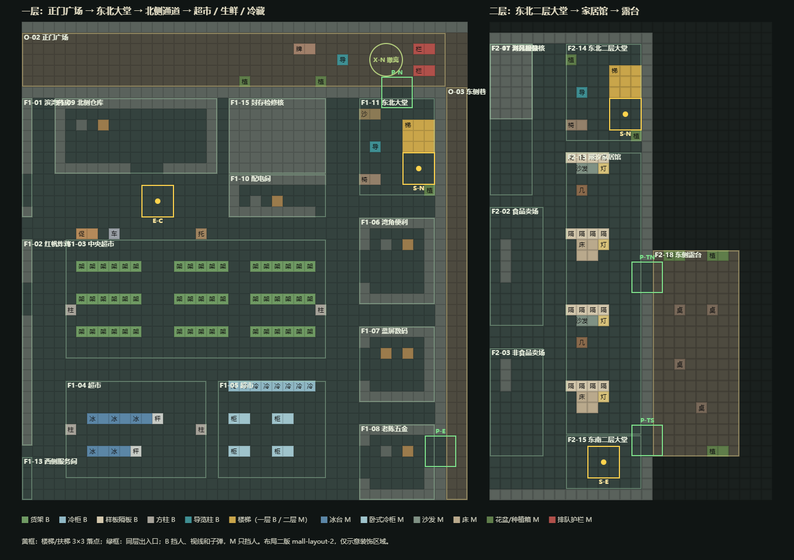
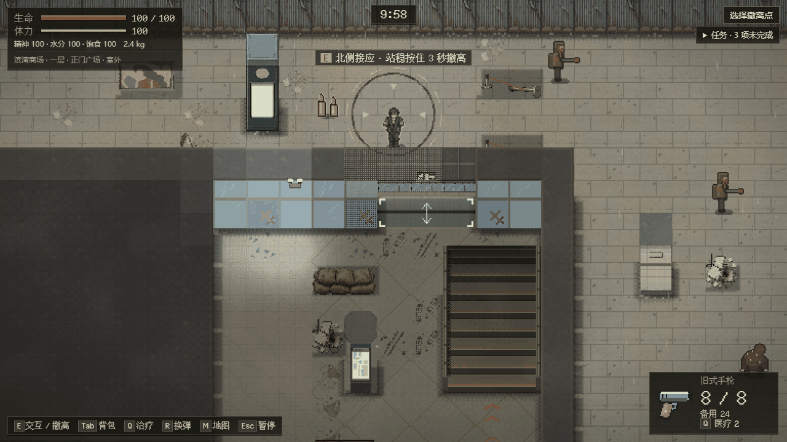
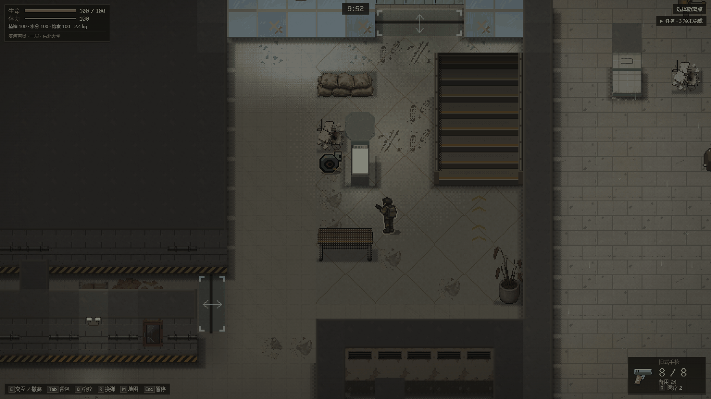
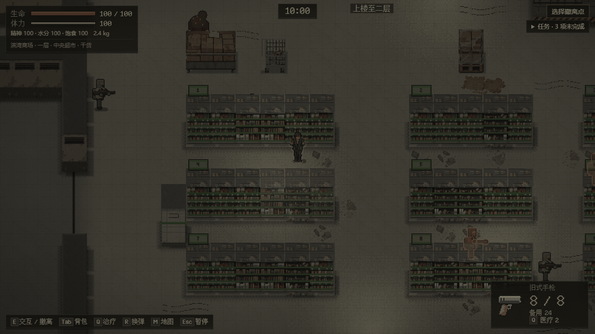
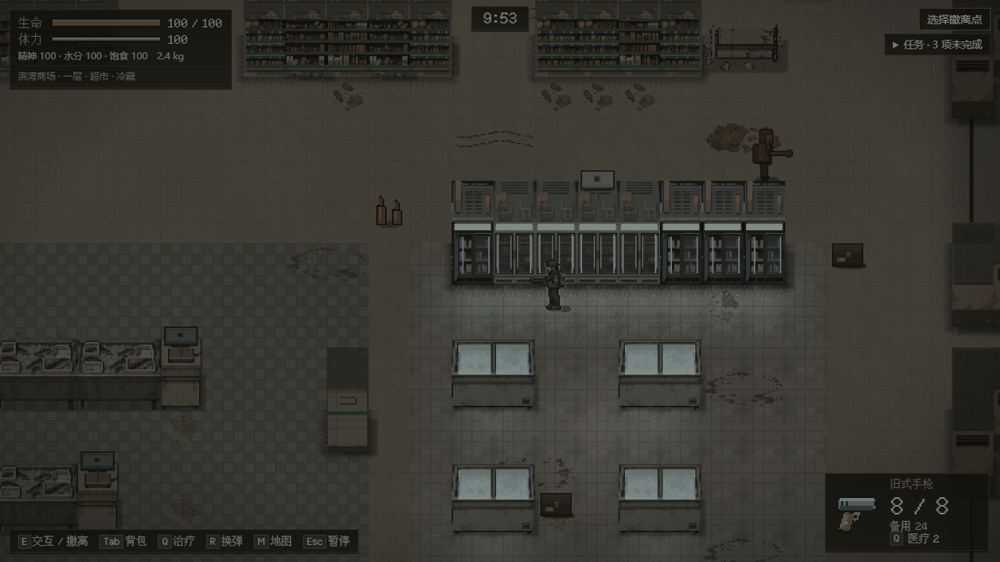
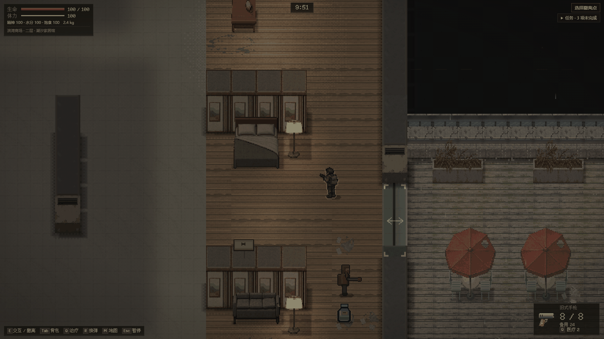
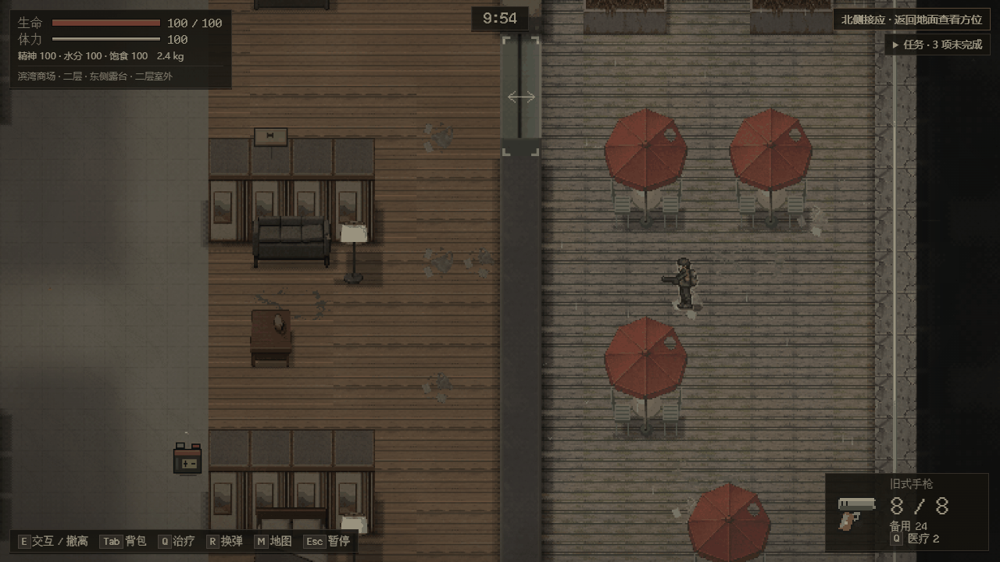
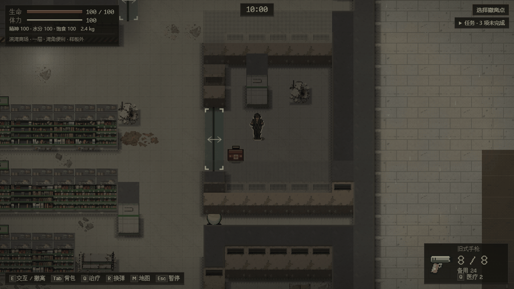
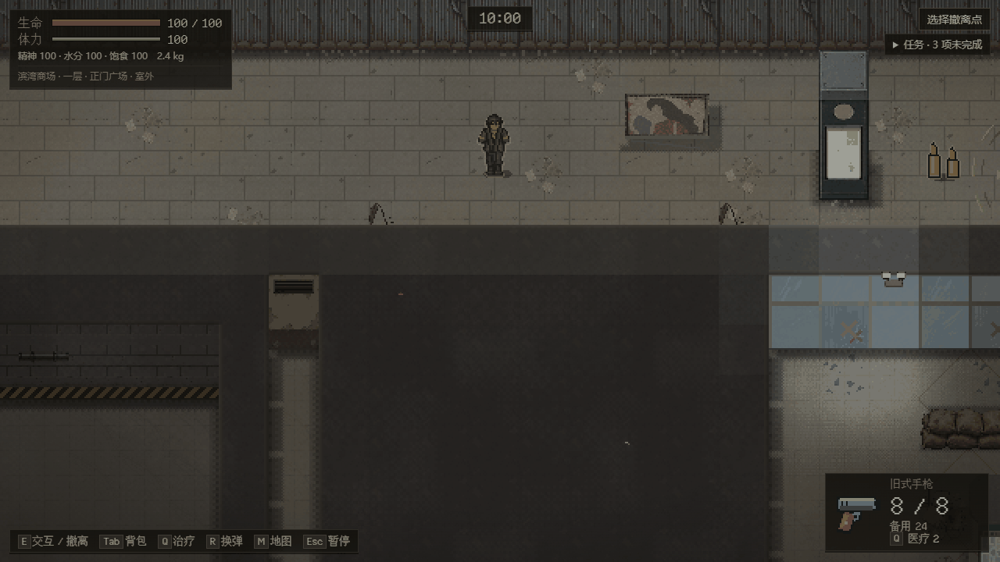

# 滨湾商场 2.5D 化

登记：[#47](https://github.com/xuys2025/escape-bincov/issues/47)。分支 `feat/mall-2-5d`，起点 main `7df2d22`。本页记录范围、维护者决定和布局二版坐标；进度以对应 PR 为准。

2026-10-13 Runtime 本地交付：独立 `agent/mall-runtime` 从本分支 `846954f` 接手，已接两版 Runtime、显式出击参数和恢复解析；[接口、实际验证、首败与 34 条用例登记](runtime-astra/README.md)。之后已合入本分支（#48）。

2026-10-14 渲染接入：`?sample=mall` 在 Pixi 2.5D 画面上跑布局二版，Sol 第一批 110 个素材入库。做法、检查结果和已知问题见下文“2.5D 样板”一节。

## 维护者决定（2026-10-13）

1. 做布局二版：卖场加货架、柜台等碰撞；外墙、房间、同层出入口、四组楼层连接、锚点和撤离点保持。新旧布局并存，进行中的旧行动按原布局恢复。
2. 先做 `?sample=mall` 样板入口，普通入口暂时不变。
3. 先做一段完整路线看效果：正门广场 O-02 → 一层东北大堂 F1-11 → 北侧通道 → 超市 F1-03/04/05 → 东北楼梯 S-N → 二层东北大堂 F2-14 → 家居馆 F2-13 → 露台 F2-18；确认后再铺满两层。

## 分工

| 部分 | 内容 | 负责 | 状态 |
| --- | --- | --- | --- |
| 布局二版 | 切片区域家具碰撞与坐标登记（本页第 3 节） | Opus | 本分支已交数据与约束测试 |
| Runtime 接入 | 运行时接受商场、`mallRunConfig`、商场楼与区域呈现、测试驱动；二版注册、显式出击参数、新旧并存恢复；34 条用例登记 | Astra | [本地交付](runtime-astra/README.md)，URL/视图接线交 Opus |
| 渲染 | 商场楼层构建、地面、墙与门头、家具、标牌、发光、灯光分区、天气与声音、切墙规则 | Opus | 本分支已接入（见“2.5D 样板”） |
| 素材 | 第一批 110 个文件（含 P1 返修与补充：沙发、床、地面、杂物贴花、倒地货架、吊顶残堆） | Sol | 已入库 `assets/mall/`，清单修订 3 |
| 验收 | 商场样板专项门禁与独立复验 | Opus 门禁，Sol 复验 | 门禁 `test:mall-sample` 已建；独立复验未开始 |

## 布局二版（`mall-v2` / `mall-layout-2`）

按世界数据绘制的平面示意，不是游戏画面。

### 规则

- 数据在 [`src/mall-layout-v2.ts`](../../src/mall-layout-v2.ts)，由 [`src/mall-world.ts`](../../src/mall-world.ts) 的 `mallWorldV2()` 在首次调用时生成。一版 `MALL_WORLD` 的生成步骤只拆成共用函数，输出逐字节不变（测试比对 SHA-256）。
- 家具逐格登记为装饰：B 物化为 `wall`（挡人、视线、子弹），M 为 `low`（只挡人），V 不改格。装饰名就是家具类型；多格件写 `类型#dx,dy`；货架、冷柜、样板隔板是东西向连排件，由视图按左右邻居选端头和中段。
- 二版只改第 1 节列出的八个区域和超市北侧临街一排（x 30–44，y 19）；其余区域保留一版的角标装饰，二层食品与非食品卖场保留一版短货架。
- 两版均注册到 `resolveExpansionWorld`，存档按原世界与修订恢复；`beginRun(..., { mallLayout: 2 })` / `deploy({ ..., mallLayout: 2 })` 显式选择二版，未传仍是一版。`initializeMallRaid` 的可选 `world` 参数默认仍是一版。

### 连接坐标

| 连接 | 一版（一层 / 二层） | 二版（一层 / 二层） | 说明 |
| --- | --- | --- | --- |
| S-W | (14,41) / (14,31) | 不变 | |
| S-N | (60,11) / (60,11) | **(62,13) / (62,13)** | 同在两层东北大堂内；一层楼梯段占 (61–63, 9–11)，立在正门东侧，不再挡在门口正前方 |
| S-E | (60,45) / (60,45) | 不变 | |
| E-C | (38,16) / (38,19) | 不变 | 扶梯本体留到后续批次 |

### 家具登记

| 区域 | 内容（格坐标为西北角） |
| --- | --- |
| O-02 正门广场 | 室外导览柱 (55,3)；排队护栏 2×1 (62,2)、(62,4)；倒伏广告牌 2×1 (51,2)；花盆 (53,5)、(46,5)。北侧撤离圈与正门穿行带不放 |
| F1-11 东北大堂 | 上行楼梯 3×3 (61,9)；导览柱 (58,11)；沙袋 2×1 (57,8)；长椅 2×1 (57,14)；花盆 (63,15)；掉落吊顶残堆 (57,10) |
| 北侧通道临街 | 促销堆头 2×1 (31,19)；购物车 (34,19)；托盘货 (42,19)。配电间南侧两行通道不放 |
| F1-03 中央超市 | 三排东西向货架（y 22、25、28），每排三段 x 31–36、40–44、47–52；第三排末段只剩 x 47–50，(51,28) 起是一节倒地货架 2×1（只挡人）；x 37–39 为三格横穿通道（对着扶梯），x 45–46 为两格；方柱 (30,26)、(53,26)；掉落吊顶残堆 (53,21) |
| F1-04 生鲜 | 冰台 2×1 (32,36)、(34,36)、(36,36) 和称重台 (38,36)；冰台 (32,39)、(34,39) 和称重台 (36,39)；方柱 (30,37)、(42,37) |
| F1-05 冷藏 | 立式冷柜一排 x 45–52，y 33，朝南；卧式冷柜 2×1 (45,36)、(49,36)、(45,39)、(49,39) |
| F2-14 东北二层大堂 | 楼梯井 3×3 (61,9)，栏杆只挡人；导览柱 (58,11)；长椅 2×1 (57,14)；花盆 (57,8)、(63,15) |
| F2-13 潮汐家居馆 | 四间样板间，各由 x 57–60 的东西向隔板开头（y 17、24、31、38）：客厅放沙发 2×1、茶几、落地灯，卧室放双人床 2×2、落地灯；x 61–63 临外墙通道直通两个露台门 |
| F2-18 东侧露台 | 种植箱 2×1 (66,26)、(70,26)、(70,44)；咖啡桌 (67,31)、(70,31)、(67,36)、(69,40)。边缘锚点 A-EDGE 周围不放 |

### 已验证的约束

[`tests/mall-layout-v2.test.ts`](../../tests/mall-layout-v2.test.ts) 与参数化后的 [`tests/mall.test.ts`](../../tests/mall.test.ts)：

- 一版 SHA-256 不变；两版分别按固定世界 ID 注册，未知修订仍拒绝。
- 装饰区域以外的格与一版一致；区域、门、三组连接坐标不变，S-N 只在两层大堂内移动。
- 家具每格类别与碰撞一致，多格件完整，只出现在装饰区域。
- 每个连接落点 3×3 无遮挡、64 像素内至少 9 个可落位（S-N 为 11）；同层开口穿行带、撤离圈和出生点 3×3 不放家具，固定锚点至少三面可走。
- 北侧主通道每列至少 3 格连续可走，扶梯横穿通道全程畅通；超市、生鲜、冷藏内相邻两排固定物之间至少 2 格；家居馆临外墙通道与西侧两格通道全程畅通。
- 一版原有 5 项（39 区域与锚点、两种潮位全图连通、25 敌 60 物资分配与守恒、B/M/V 通道一致、两层隔离射击）在二版上同样通过。

## 2.5D 样板（`?sample=mall`）

### 怎么打开

双击仓库根目录的 `商场试玩.html`，或打开 `start the game.html?sample=mall`。进入水产站后出击区域已选好“滨湾商场”，种子可留空。出生在正门广场西端，面朝正门。想要像素更整齐、走动时不闪的画面，可以在地址后加 `?crisp=1`（`商场试玩.html?crisp=1`）：画面按整数倍放大，1280×720 下能看到的范围从 24 格宽变成 20 格宽。不带 `sample` 的普通入口不变：商场仍是布局一版，在原来的 Phaser 画面上跑。

### 截图

`test:mall-sample` 在本分支打包产物上的实际画面（压成 256 色存放）：

| | |
| --- | --- |
|  一层正门广场，外立面不切 |  一层东北大堂，1920×1080 |
|  中央超市，前面的货架淡出 |  生鲜与冷藏 |
|  二层家居馆样板间，1920×1080 |  二层露台，两格宽的桌椅组，楼外临空 |
|  便利店侧门的入口提示，房间墙剖开但挡路的格子保持实心 |  `?crisp=1` 整数倍缩放，开局在正门广场 |

### 入口与存档

- `?sample=mall` 时新出击用布局二版（标签页和水产站出发都一样），存档里是 `mall-v2`；继续行动按存档里的布局恢复。样板只画 `mall-v2`，其他行动照旧走原画面。
- `?sample=village` 的行为不变（仍预选居民楼，空种子仍挑城中村出生点）。
- 存档格式、Runtime 规则和普通入口都没有改。

### 画法

- 地面：每格按区域选 Sol 的地面图，64 像素的图按格子奇偶取四分之一，跨块拼接不错位；滩涂格仍画泥地，潮水照旧盖上去；二层楼外临空处画两层楼下的暗色街面。杂物贴花和墙、家具的投影烘进地面块。
- 墙：同一种墙（顶面、哪几边露边、立面、女儿墙栏杆）只画一张图。一层地图边是封锁围挡，二层楼外只有露台一圈画矮女儿墙，其余临空不画墙。东西向的真入口上画门头（大门用入口门头，其余用卷帘门头），顶面和墙顶对齐；南北向侧门南边那段墙压低成两级台阶，让门洞露全。
- 家具：每件一张图，按占地南边线排前后，玩家走到后面时会淡出，敌人在后面显示轮廓。货架端头立通道号牌（1 到 9 号，从北到南、从西到东），生鲜、冷藏、家居的牌子画小图标。未布置区域里没有名字的低矮碰撞格放一件替身杂物（托盘货、倒地购物车、沙袋、残堆），没有名字的孤立单格画成柱子，其余没有名字的墙格画成墙。露台咖啡桌是程序绘制的一组桌椅。
- 发光：冷柜、导览柱、落地灯、出口灯、应急灯、玻璃幕墙和二层窗户叠一层发光图，跟着所属家具或墙一起淡出。
- 灯光：吊顶已切掉，所以灯管只给光、不画灯具；坏灯管会闪（系统“减少动态效果”时不闪）。冷柜、落地灯、导览柱、出口灯和应急灯有自己的小光，玻璃幕墙往室内透一点天光。灯光仍按房间是否揭示开关。环境光分三种：楼体内是室内，广场和露台是室外，二层临空更暗。
- 切墙：玩家所在房间的墙（连同它的南墙）剖开，进出房间各有一格缓冲；在走廊里剖开所在那段走廊正前方一两排的墙；北面和东西两侧外墙不剖。剖开的墙只虚化墙顶和上半截立面，挡路的那一格保持实心。挡住玩家的墙仍按原规则淡出。
- 入口：每个连接两个不同地方的门洞（两层共 21 个）在 9 格内显示城中村那种绿色门角标和双向箭头，画在墙的上层，墙挡住时也看得见；地面有一道门槛线。
- 楼梯：已画出的 S-N 楼梯不挂名字，地面画两道黄色箭头指向楼梯；其余楼梯 8 格内用 HUD 像素字显示名字，站在楼梯口时让给头顶提示。
- HUD：显示楼层和所在地点（室外地点如正门广场、东侧露台也显示），未布置的房间稍暗并标“样板外”。
- 天气与声音：雨只下在楼体以外（一层广场、二层露台），进楼后雾在半秒内散掉，室内不飘纸屑；海声在楼体内闭合，广场和露台是室外。
- 没有素材时（`&art=placeholder` 或素材解码失败）商场仍用通用占位画面，能玩。

### 顺带修的共用问题

- 房间重叠时（例如二层 F2-06 包着 F2-10），画面层原来按“第一个包含的房间”判断，外层已揭示、内层未揭示时可能漏出子弹、火花、血迹、命中标记、方向提示和受击声。现在与 Runtime 一致：所在的每个房间都揭示了才显示。
- 命中标记和受击声原来只看弹着点。弹着点在目标周围一圈上，目标贴着房间边缘时会落到房间外的走廊里，于是未揭示房间里的敌人被打中也会提示、出声。现在还要看目标本身是否可见。尸体溅出的血和血泊也跟着尸体所在的房间隐藏。这两处在本分支之前就有。
- 撤离点在 Runtime 发布它的任何楼层都列出和指引（原来只在沿海大地图）。
- 图集页改为每帧最多上传一次，避免重建或淡出时整页反复上传。

### 检查

- `pnpm test`：356 项通过。新增 [`tests/mall-view.test.ts`](../../tests/mall-view.test.ts) 8 项（重叠房间、只剖开所在房间及进出缓冲、走廊剖开、外立面保护、环境光分区、替身杂物、通道号、按目标判断命中反馈、咖啡桌组、海声）；布置表测试按完整清单核对两层入口，并检查门头只在真入口；布局与分配测试补了二版出生点和出生点周围 240 像素内不放敌人、物资。
- `pnpm test:mall-sample`（[`scripts/mall-sample-test.mjs`](../../scripts/mall-sample-test.mjs)，CI 的 world 组）：18 项（试玩反馈后加了楼梯标签与地面箭头、家具底边阴影、入口提示与 HUD 地点名、清晰缩放，并把剖开检查改成新规则）；最初的 15 项覆盖二版出击、布置与淡出联动、广场看外立面不切、重叠房间里的敌人不漏、房间边缘的隐藏目标不出命中标记且血迹不漏、S-N 上下楼、撤离点只在一层、雨只在楼外、5 次重挂计数不变、1920×1080、水产站无测试接口出击、普通入口仍是一版、无素材时楼内也不下雨、村庄样板入口不变、跳转页。截图在 `test-results/mall-sample/`。用修复前的包对照，边缘命中、边缘血迹和无素材下雨三项都会失败。
- 最终包上本地复跑：村庄样板全量 `scripts/coast-sample-test.mjs` 51/51，`test:coast-render-targets` 5/5，`test:mall-landing` 通过，`test:mall-passages` 7/7。
- 代码审查：5 个方向（村庄回归、信息泄露、资源与性能、入口与存档、商场画法）各一名审查者，每条发现另由一名验证者尝试推翻；确认的 6 个问题均已修复（上面两条共用问题、无素材时楼内下雨、门头误判、楼梯井淡出露地砖、露台栏杆转角接不上）。

### 试玩反馈与处理（2026-10-14）

维护者试玩 `c1b9671` 后报了四个问题，处理如下（逐条原因与证据记在本地试玩记录里）。

| 问题 | 原因 | 处理 |
| --- | --- | --- |
| 露台桌椅缩放不对 | Sol 的咖啡桌把一张桌子和两把椅子挤在一格里，比伞和人物都小一大截 | 桌椅组按人物和伞的比例程序绘制，约两格宽，以原来那一格为中心，椅子伸到两侧格子上；碰撞仍是原来的一格（改成两格会让此前存下的二版行动读档失败），伞杆立在桌子中心 |
| 沙发和床像浮在地上 | 素材底部留了 12–18 行透明，阴影却按整格画，落在物体下方的空地上 | 阴影从素材实际底边开始画，底边加一条接触暗线 |
| “上楼至二层”标签突兀、马赛克 | 标签是画在世界里的 10px 小字，随画面按 1.67 倍放大变糊；挂在楼梯交互点下方，离楼梯本体两格；整层常亮 | 楼梯名改成 HUD 文字，用游戏的像素字体；站在楼梯口时让给头顶提示。商场里已画出的楼梯不挂名字，地面画两道黄色箭头指向楼梯；其余楼梯 8 格内才显示。城中村的显示规则不变，只是字变清楚 |
| 不知道哪里能进门、走起来晕 | 墙画在它挡路的格子以北一格半，侧门只露出一半，窄过道看着像墙；商场没有城中村那样的门提示，20 个入口 17 个什么都没画，另有 6 段门头放在不是门的地方；身边的墙随走动不断变成网点，每秒切换十几到二十几次；1.67 倍这种非整数缩放让细节走动时发抖 | 只剖开玩家所在的房间（进出各留一格缓冲）；在走廊里只剖开所在那段走廊正前方一两排的墙，沿走廊走时不变；北面和东西两侧的外墙不剖，南面外墙随它北边的房间剖开；剖开的墙保留整格实心墙脚。每个入口（一层 12 个、二层 9 个，厚墙上的门洞算一个）画城中村那种绿色门角标和双向箭头（墙挡住时也看得见），地面加门槛线，门头只放在真入口上；侧门南边的墙压低成台阶，让门洞露全；孤立的单格柱子画成柱子。出生点改在正门广场，一层楼层名改为“一层”，HUD 显示广场、露台等室外地点名，未布置的房间稍暗并标“样板外”，室内不再飘纸屑。整数倍缩放先做成可选的 `?crisp=1` |

修正后又做了一轮多代理审查（世界数据与存档、入口与剖开、画面与 HUD、测试是否可信，每条发现另有验证者复核），确认的问题已全部修复：咖啡桌碰撞改回一格以免旧存档读档失败；走廊补上上面那条剖开规则；外立面只保护北面和两侧；入口改按最内层房间比较、转角只认横穿的墙、厚墙门洞合并；城中村楼梯名的显示规则恢复原样（只在商场里让给头顶提示），城中村空间验收改为检查屏幕上的 HUD 文字；淡出的家具按素材实际底边保留实心；补了出生点周围不放敌人、入口完整清单、外立面保护等测试。

以下几项会连带改动城中村样板，或者属于取舍，留给维护者决定，本批没有改：整数倍缩放要不要变成默认；镜头取整方式（消除人物相对背景的细微抖动）；瞄准时镜头往鼠标方向前探要不要减小；房间灯光揭示时要不要淡入；商场墙要不要整体降低；房间要不要像城中村那样有天花板、进门才掀开。

### 已知问题

- 外立面朝外的一面暂用室内立面图（Sol 这批没有外立面图），只有正门玻璃幕墙和地图边围挡是专门画的。
- 未布置区域只有替身杂物和少量垃圾，地面是通用大砖（现在稍暗并在 HUD 标“样板外”）。
- 1 格和 2 格宽的东西向窄过道（二层 y27、y34、y41，一层 y18–19 的死胡同等）仍会被南边的墙顶盖住大半，属于布局问题，等决定铺满两层时一起改。
- 长椅、沙发、床的碰撞仍是整格，比画出来的物体往南多出 12–18 像素；咖啡桌组的椅子画在两侧可走的格子上；楼梯 S-W、S-E 和扶梯 E-C 仍是一格的通用小图。
- 每层地面块在本次视图里一直保留，走遍两层约 35 MB 显存加同样大小的画布内存。
- 墙、家具和发光是静态布景，不按房间揭示隐藏（楼层没有天花板，房间布局本来就看得到）；不属于任何房间的走廊格照 Runtime 规则总是可见。
- `scripts/coast-launcher-check.mjs` 已过时：它假定普通入口直接进标签页，现在普通入口先进水产站画面。它不在 CI 里，本批未改。
- 手感、掩体和敌人路线仍需真人评估。

## 待办

- 维护者看样板路线的效果，确认后再铺满两层（剩余区域的家具登记和素材）。
- Sol：外立面朝外一面、未布置区域的店铺家具（下一批再定）。
- 一版与二版的选择只发生在出击时；已开始的行动保持原世界与布局。
