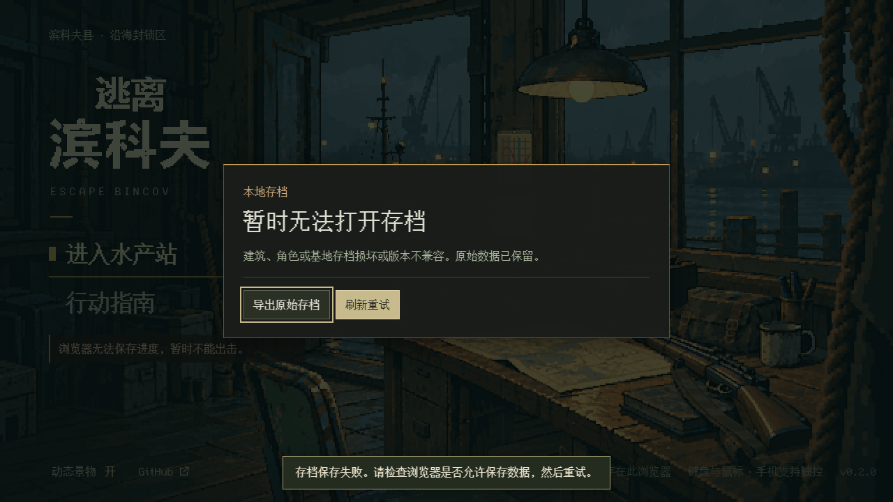

# 商场 Runtime 接入与布局二版兼容 · 本地交付

日期：2026-10-13（新加坡时间，UTC+8）。承接 #47 / 草稿 #48 的阶段 2，按本地《Astra-Runtime 接入任务书》执行。工作树 `D:\bincov\mall-runtime`，本地分支 `agent/mall-runtime`，起点为 `feat/mall-2-5d` 的 `846954f5195a2036aa73b23432e1173787ae0861`（含本地家具布置表）。接手 fetch 与交付前 `ls-remote` 均确认远端 main 为 `7df2d222210c803ae69ae60e9e709b8db0b12cd2`，#48 远端 head 为 `b188e0fa7ff5199bf0980caa7fdb92ae64b80e3c`。

两版商场已经可以使用真实 Runtime；布局二版已注册恢复解析，出击须显式选择，现有调用默认一版。完成本地提交后停止；没有推送、开 PR、合并、部署或更新试玩站。此文和下面证据是本次阶段交接；`?sample=mall` 的完整可玩视图仍由 Opus 接线。

## 改动清单与边界

| 文件 | 本次改动 |
| --- | --- |
| `src/expansion-worlds.ts` | 注册惰性创建的 `mall-v2`，保留 `mall-v1`；未知 ID 仍返回 undefined |
| `src/session.ts` | `beginRun` 的第三个可选参数选择商场布局，仅作用于新行动；出击仍一次原子提交 |
| `src/hideout-runtime/contract.ts`、`runtime.ts` | `deploy` 增补并透传 `mallLayout`；`startRaid` 不再次出击 |
| `src/raid-runtime/runtime.ts` | 构造门禁允许城中村及两版商场；两版商场使用 `mallRunConfig` |
| `src/raid-runtime/presentation.ts` | 每层发布一栋商场、室内区域归属、室外区域不挂建筑；原城中村输出不变 |
| `src/mall-world.ts` | 只更新注册状态的注释，世界生成数据不变 |
| `tests/mall-layout-v2.test.ts`、`mall.test.ts` | 保留一版哈希与布局约束，将“未注册”断言更新为正确注册；两版均走生产解析器 |
| `tests/mall-runtime.test.ts` | 新增 19 组 Runtime / 会话验证，覆盖下方 G/L/S 条目 |
| `scripts/mall-runtime-compat.mjs` | 实际 main HTML 对照、新 Runtime 浏览器恢复、原生导入及双窗口检查 |
| 两份 HTML、两份 ZIP、`docs/release-manifest.json` | 由 `pnpm package` 生成 |
| 本目录及上级 README | 实际结果、首败、接口与后续归属 |

`src/coast-view/`、`src/station-view/`、`assets/`、`src/mall-layout-v2.ts`、原 `tests/raid-runtime.test.ts` 均与起点一致。一版世界 SHA-256 仍为 `1c4ef1c490c41854c7587f6a1ca167d7ef8859b7e3c698e800bbeef570757ffd`。没有新存档键、格式版本或依赖。

实时检查发现 #44 也涉及上述三个 Runtime/contract 文件。任务书 A1/A2 明确要求的修改只落在 `deploy` 签名/透传和 RaidRuntime 构造处；#44 的库存操作及 overlay 清理位置未改。共享生成物按任务书 A5 打包。没有修改 #43/#44 的 CI、package.json、脚本、库存实现、视图、资产或全局 handoff/WORK-QUEUE；本目录承担本阶段交接，避免改其共享文档。Opus 合入 #44 后再合本提交时应正常核对这些文件并重新打包。

`createTestCoastHost` / `createRuntimeTestDriver` 原实现已按 `runtime.layeredWorld` 校验位置，无需修改。注册与门禁接通后，两版 `mall-f1` / `mall-f2` 可直接使用；非法坐标继续由 `checkpointBodyFits` 拒绝。潮汐、追击、来源层弹丸结算、切层事务和重试沿用原多层内核，没有发现须添加商场特判的规则分支。

## 实际验证：通过

环境：Windows，Node **24.21.0**，pnpm **11.19.0**，Chrome **155.0.8059.40** 无头。浏览器兼容性夹具 1280×720；既有建筑回归另有 844×390、640×300 触控仿真。Runtime 用内存存储故障与显式测试驱动，浏览器兼容用真实 localStorage、原生备份文件选择和确认；模拟时间不代表真人手感或性能。

最终两份 HTML 为 3,630,276 字节，SHA-256 **`d14cc1360a433657240888de95de48f22970f683aeca167cc7f095855c7ebab6`**。最终重打包与所有浏览器受检 HTML 字节一致。所有测试所用进度均为自动生成夹具，不含真实玩家存档。

| 命令 | 结果与证据 |
| --- | --- |
| `pnpm install --frozen-lockfile --registry=https://registry.npmjs.org` | 通过，锁文件不变 |
| `pnpm test` | **326/326 PASS**，含新增 19 组和原城中村/经典断言；[完整日志](evidence/unit-final.txt) |
| `pnpm exec tsc --noEmit` | PASS |
| `pnpm package` | PASS，[打包日志](evidence/package.txt)，制品见仓库发布清单 |
| `node scripts/mall-runtime-compat.mjs 7df2d222210c803ae69ae60e9e709b8db0b12cd2` | **6/6 PASS**，[真实对照报告](evidence/compat-report.json)；实际运行未传参数，当时 `origin/main` 正是该 SHA |
| `pnpm test:expansion` | **5/5 PASS**；实际旧 v3 HTML 为 `07b1414…`，[报告](evidence/expansion-browser-report.json) |
| `pnpm test:mall-landing` | **2/2 PASS**；原 Phaser 一版回归，[报告](evidence/mall-landing-report.json) |
| `pnpm test:mall-passages` | **7/7 PASS**；原 Phaser 一版，每开口慢走/冲刺各 10 往返，[报告](evidence/mall-passages-report.json) |
| `pnpm test:save-browser` | **9/9 PASS**，[报告](evidence/save-browser-report.json) |
| `pnpm test:buildings` | **8/8 PASS**，[报告](evidence/building-browser-report.json) |
| `pnpm test:portable` | **6/6 PASS**；实际解压 ZIP、普通入口无测试钩子和外部请求，[报告](evidence/portable-report.json) |
| `node scripts/runtime-differential.mjs` | 经典/城中村 × 两种子，**4 × 240 帧逐帧完全一致**；模拟时钟，[报告](evidence/runtime-differential.json) |
| `node scripts/build-coast-runtime.mjs` | PASS，纯 Runtime 包无 Phaser/Pixi/测试驱动依赖，[依赖与哈希](evidence/runtime-module.json) |
| `git diff --check`、本地密钥检查及提交钩子 | PASS；[本地边界与制品检查](evidence/review-checks.json)，提交钩子保持启用，无绕过 |

五套指定浏览器回归的完成时间与退出码见[执行清单](evidence/regression-results.json)。既有 mall 脚本仍验证普通入口一版，不把它们算成商场二版视图已验收。

兼容性对照特意使用 `git show 7df2d22:dist/index.html` 的真实旧客户端，SHA-256 为 `e21266f8843b6b7fe82f950794c66fe3fe586cd14fec8145aca55fda3df556ed`，没有替换成模拟旧解析器。旧 HTML 生成的一版行动由新 Runtime 恢复，完整 expansion 一致；放弃结算的 profile、expansion、terminal 与旧 HTML 的原生确认流程完全一致。二版 F2 的刷新与备份导入保持世界、修订、层及完整状态；当前游戏的导入取消、配额失败、确认和刷新均通过。旧 main 单独持有写锁时仍拒绝二版主档，调用 persist 和刷新后都保持原始字节。



旧 main 对照 HTML 留在本地 `test-results/mall-runtime/main-reference.html`，可由上述 Git 对象复现；未把整份旧构建复制进文档目录。

## 首败与排查记录

以下失败均保留，没有用最后一次成功覆盖原始证据。入库文本统一 LF 并清除行末空白；原命令日志仍在本树 test-results/mall-runtime/。

| 首败 | 原因、处理及当前状态 |
| --- | --- |
| 本地离线安装 | 初始 PATH 为 Node22/pnpm11.25；切换到项目规定的 Node24/pnpm11.19 后，本树离线 store 仍缺包。按锁文件联网安装成功；没有改锁文件或依赖。`pnpm exec tsc` 初次未找到本树 `.bin`，补测试进程 PATH 后通过 |
| 新 Runtime 单测首轮 7/12 | [原日志](evidence/first-unit.txt)。夹具错误：对未结算 Runtime 调 dispose、同一个 pressed 重复投递、敌方子弹缺 owner、未堵满落点却期待等待、超时夹具在故障开启前未建立对应检查点。分别改为 cancelStart、一次按下沿、真实 roster owner、堵满全部合法站位、先保存 599.9 秒再故障；未改产品规则 |
| 第二/三轮输入与终局夹具 | [第二轮](evidence/unit-02.txt)、[第三轮](evidence/unit-03.txt)。持续输入新的非零 move 时 Runtime 会移动；文档原契约要求宿主在 layer 事件释放移动。测试明确模拟宿主释放，不把物理长按移动签收。火力抑制只针对切层前已持有输入，新按下应可开火；修正夹具让 fireHeld 在切层帧已为 true。超时首个零时长帧触发检查点故障的问题通过先保存目标时刻解决 |
| 新增库存用例首轮 17/18 | [日志](evidence/unit-05.txt)。夹具缺 LootTransfer 的 runId/containerId/x/y，先被合法参数校验拒绝，尚未触发存储失败。补齐真实目标和合法格位；随后原子回滚、重试、返还、尸体和锚点箱检查通过 |
| 实际 main 对照首轮 | [报告](evidence/compat-first-report.json)。测试直接调用底层结算后没有切换旧 Phaser 场景，旧 HUD 继续读已清除的 loadout。改走原生“放弃→确认”流程，零页面错误；未更改旧 HTML |
| 原生导入首轮 | [报告](evidence/compat-02-report.json)。此前 4 项兼容对照已通过，导入停在未打开“据点”页签、找不到 `#backup-file`。补真实页签操作后完整 6/6；原数据保护断言没有放宽 |

最终专项、完整单测、指定浏览器回归没有剩余失败。G-07 的实际宿主移动释放验收继续归 Opus；其边界不会因无渲染 Runtime 测试通过而自动关闭。

## 34 条商场用例登记

来源：[MALL-VALIDATION-MAP 第 7 节](../../MALL-VALIDATION-MAP.md)。G/L/S 共 **28 条已进行二版 Runtime 复验并登记**。本表 PASS 表示所述 Runtime / 存档规则已实测；PARTIAL 表示原用例仍含未完成的画面、物理输入或更广组合。按完整原用例边界保守登记：**19 PASS、9 PARTIAL、6 未运行**。没有把无渲染状态测试等同于新视图验收。

Runtime 证据是 [19 组专项源码](../../../tests/mall-runtime.test.ts) 与 [326 项完整运行日志](evidence/unit-final.txt)；浏览器证据按行补充。默认二版种子 42，G-06 同时跑一版；配置覆盖种子 1–20；L-08 搜索两种初始潮位；L-09 遍历三撤离组合；S-09 自动选 X-N/X-L 启用、X-S 未启用的种子。

| ID | 状态 | 本次实际复验 / 尚余边界 |
| --- | --- | --- |
| G-01 | PARTIAL | 7 开口 Runtime 慢走/冲刺各 10 往返、斜向贴边、原层及物资不变；屋顶/区域实际画面待 Opus |
| G-02 | PARTIAL | 弧形墙/菱形岛拒绝站位、全图两潮位可达性、路径段身体半径通过；完整贴边观感与轮廓待视图 |
| G-03 | PARTIAL | 各开放区域 Runtime 寻路、逐段不剪角，双潮位及三出口组合；全货架通道人与敌人连续跟随画面未录制 |
| G-04 | PARTIAL | 每个注册装饰的 B/M/V 身体、视线与实际 Runtime 弹丸规则逐项通过；图片轮廓待接入 |
| G-05 | PARTIAL | 乐园外圈合法点、球池/栏外/地下/墙内拒绝、露台边缘合法；完整实景贴边观察待视图 |
| G-06 | PASS | 两版四组连接各 10 次双向往返，共 160 次切层；落点、全实体唯一性、状态与刷新一致 |
| G-07 | PARTIAL | 面板阻止切层；原有 held E/fire 抑制、松开重按；宿主释放移动后 5 秒不移不连切。二版物理长按由 Opus 视图阶段验 |
| G-08 | PASS | 原 25 身份摆满目标合法站位，拒绝时世界不变；清一格后按确定顺序落位且只换层一次 |
| G-09 | PARTIAL | 装饰 ID 不作为箱子被打开、碰撞类别与地图输出通过；两层不看名字辨店/招牌与材质未人工验收 |
| L-01 | PASS | 双层同坐标敌人，双向真实 Runtime 射击仅本层掉血，另一层完整状态不变 |
| L-02 | PASS | 双层同坐标不同 ID 的散落、箱子、真实死亡生成尸体；各层取一份/放回，另一层引用拒绝，另一层不变。尸体库存使用明示确定夹具 |
| L-03 | PASS | 双向发枪，本层遮挡敌人调查声源；切层后另一层 noise 为空、敌人原状态保持 |
| L-04 | PASS | 四连接各三名追击者，经真实登记路径到入口并保留 ID/HP；再从另一连接反向追击，身份仍唯一 |
| L-05 | PARTIAL | 目标全部合法格堵塞后排队；腾空后全部抵达、来源时间冻结；人为封闭另一支路的更广路线组合未另改世界数据测试 |
| L-06 | PASS | 命中、撞墙、射程和敌弹来源层结算一次；血量/击杀/尸体/弹丸/RNG 同次回滚，重试、等待和返回不重复结算 |
| L-07 | PASS | 露台仍 mall-f2/二层，室外 region 不挂建筑；同坐标地面物资不可拾取、附近列表不串层，按住不撤离 |
| L-08 | PASS | 两种初始潮位，270/300 秒预警/翻转各一次；O-06 受淹，店内/F2 干燥，换层与刷新不重置；干路由 L-09 交叉验证 |
| L-09 | PASS | 双潮位、全部三种出口组合、各开放区域 Runtime 合法路径；全可走格连通由两版原 mall 测试守护 |
| S-01 | PASS | 原 A-BOX-1/2 各取一份，经楼梯往返和刷新保留两箱余量与同一背包；另有同坐标容器隔离 |
| S-02 | PASS | 切层配额失败原字节/完整世界不变；保存恢复后重试仅一次换层 |
| S-03 | PASS | 保存前后分别恢复对应层；失败未提交候选刷新回成功点；浏览器 F2 刷新也通过 |
| S-04 | PARTIAL | Runtime 面板态拒绝切层、旧层目标校验、关闭释放后可切；真实拖动指针生命周期待视图 |
| S-05 | PASS | 取物写入失败双端回滚；取物成功后切层失败仍保留交易；重试/刷新不重复拿物 |
| S-06 | PASS | Runtime 过期会话写入/切层/终局拒绝；当前实际 HTML 两同源窗口写锁拒绝第二页，字节不变 |
| S-07 | PASS | 实际 main 一版行动新端恢复与结算一致；二版未知世界、未知修订及 ID/修订错配拒绝不覆盖；旧 main 实际 HTML 拒绝二版 |
| S-08 | PASS | 二版 F2 活动备份导入到新会话；当前游戏原生取消/配额失败/确认/刷新均保留完整状态，见兼容报告 |
| S-09 | PASS | X-N/X-L 启用、X-S 不启用；提前松开与移动重置，停稳 3 秒才结算；失败保留 pending，重试奖励一次 |
| S-10 | PASS | F1/F2/露台 × 死亡/超时/放弃九组合，故障后安全箱保留、背包/主枪损失规则一致，重试只结算一次 |
| U-01 | 未运行 | 二版 HUD/地图、1280×720 与 1920×1080 实景、预览另一层待 Opus |
| U-02 | 未运行 | 二版实际触控输入与面板出口待 Opus |
| U-03 | 未运行 | iPhone/Android 真机不在本次环境 |
| P-01 | 未运行 | 二版自然三局、帧时间与持续负载待完整视图；本次模拟不替代 |
| P-02 | 未运行 | 二版视图跨局清理与长期内存待完整视图 |
| P-03 | 未运行 | 普通现有离线包回归已通过；二版样板尚未接入，二版完整离线入口留 Opus |

## 给 Opus 的接口与合入说明

```ts
// 旧页签：只有新出击选择布局；未传第三参仍为一版。
saveSession.beginRun(seed, 'mall', { mallLayout: 2 });

// 院子：选择参数随正式 deploy 提交，动画完成只调用一次 startRaid。
const result = hideoutRuntime.deploy({ world: 'mall', seed: '42', mallLayout: 2 });
if (result.ok) hideoutRuntime.startRaid(result.runId!);

// state.state === 'run' 后，生产宿主工厂继续使用原名字/接口。
const host = createCoastRaidHost(state, saveSession);

// 仅测试入口；生产入口不要导入 test-support。
const testHost = createTestCoastHost(state, saveSession, '?test=1');
testHost.driver.freezeAI(true);
testHost.driver.placePlayer({ x: 2000, y: 432 }, 0, 'mall-f2'); // 二版 S-N，像素坐标
testHost.driver.kill(testHost.runtime.current().frame.actors[0].uid);
```

`mapView` 两层各一栋：`id = ${worldVersion}/${layoutRevision}/${mapId}/building/mall`，`name = 滨湾商场`，`kind = mall`。矩形字段单位为像素：`x=256, y=192, w=1824, h=1376`，即含外墙格的 x **8–64**、y **6–48**。`regionIds` 只列该层 `inside=true` 区域（含 sealed 的建筑内部）；`O-*` 与露台 `F2-18` 的 `buildingId=null`。二层 `exits=[]`；一层两个出口由该行动 seed 的 `mallRunConfig` 决定。

恢复时使用已校验主档的 worldVersion/layoutRevision；不得因 URL 参数变化重新 beginRun 或将二版转换成一版。Runtime 已据存档选择正确世界和 runConfig。视图缓存须使用完整 world key，不要只看两版共用的 `mall-f1` / `mall-f2`。

Opus 必须补的接线：

1. `?sample=mall` 的读取、旧页签及院子两个出击调用处传 `mallLayout: 2`；普通入口保持省略。
2. 商场样板启用判断、恢复时宿主选择和渲染映射按保存的两版世界接管；恢复优先于新出击选项。
3. 特别核对 `src/ui.ts` 的 **enter 恢复分支**：目前仍以 `worldVersion === 'mall-v1'` 选择 Phaser `mallRunConfig`。样板/普通入口恢复二版时必须避免退到该错误配置；`startPreparedHideoutRaid` 则已用 `startsWith('mall')`。本文件属于 #44 / Opus 接线范围，本次未改。完整样板发布前必须处理并复验。
4. 沿用原层事件宿主契约，切层释放物理移动、按下沿和拖放；Runtime 内部的 held 抑制是附加保护。G-07/S-04 的物理输入不得凭本次无渲染结果直接勾完。
5. 三个共享 Runtime/contract 文件与 #44 的修改位点不同；正常合入后复核并重新 `pnpm package`。现有图像、风格和家具布置由原负责人继续；本次未提出家具数据调整。

## 未运行与遗留

- #48 的完整远端 CI 未运行：按维护者指令仅本地提交，未推送。不能据本次本地通过将 #48 转 Ready。
- U/P 六项及上表 PARTIAL 的画面、输入、真人、真机部分仍待 Opus/Sol；没有二版视觉性能或完整样板离线签收。
- 没有运行 `test:play` 自然 10 分钟、全部 UI/手机套件或扩大量性能检查；本次未改战斗/AI/潮汐内核及视图。相关规则由新增专项、原单测、真实经典/城中村差分和指定回归验证。
- 现有 F20、历史存档未确认问题及其它 PR 的遗留状态不在本次关闭范围。
