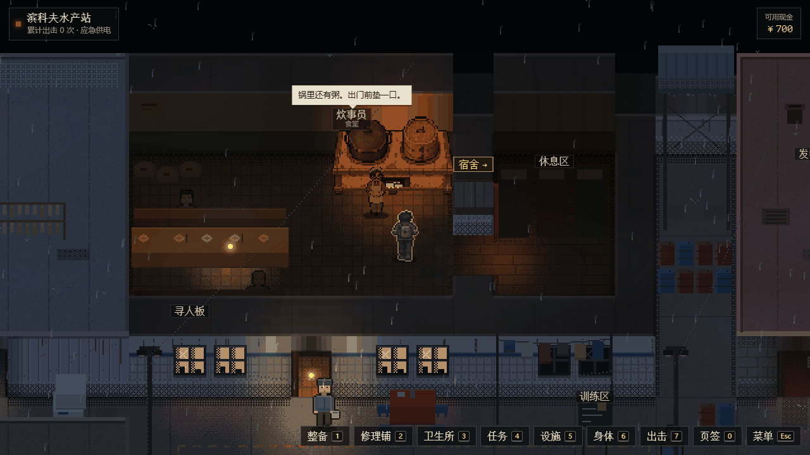
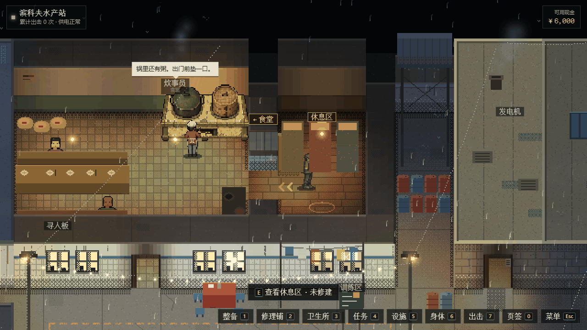

# 水产站：食堂进不了宿舍（2026-10-14）

维护者截图问：食堂到宿舍中间的路是不是被挡住了，过不去？是的。

## 原因

宿舍只有一扇门，开在食堂和宿舍共用的那面墙上，格子 (17,4)。食堂的案台（`pots`，放锅和水盆的矮台，占 1×2 格，挡路）摆在 (16,4)–(16,5)，正好占住门里侧那一格。

院子的碰撞（`src/station-view/nav.ts` 的 `Collision`，脚框 12×7 像素）在门这一行只有 26 像素宽能走，这一段全被案台挡住，所以人从食堂进不了宿舍。宿舍里的休息区站点（半径 44 像素）也就走不到。

实测（真实打包、真实键盘输入）：
- 站在门边 (15.8, 4.6) 按住向右走 1.2 秒，人原地不动。
- 从案台上方往右下挤，会卡在门框边 (16.8, 3.93)。

## 为什么一直没测出来

`scripts/station-browser-test.mjs` 的 H1 本来要检查“食堂→宿舍”，但它只看宿舍屋顶有没有掀开。人走到门口时屋顶就会掀开，所以人没进去这一步也照样通过。E1 修建休息区时是直接把人放进宿舍，也没有走门。

## 改动

- 案台挪到 (16,5)–(16,6)：贴着东墙，在宿舍门下方。门里侧空出来；不挡食堂南门 (13,7)，也不挡炊事员。画法不变。
- 新增 `tests/station-layout.test.ts`。它把所有道具同时立起来（这是任何存档能出现的最多障碍），用院子自己的碰撞规则从院子出发做可达性搜索，检查：
  - 每个房间都走得进去；
  - 每扇门两侧都到得了；
  - 每个交互点在半径内有能站的位置；
  - 宿舍门里侧没有挡路的道具。

  修复前这四项全部失败，其中一条是“休息区走不到”。
- H1 的侧门检查改为：人的脚必须真的走过门（宿舍要过 x=18，电台要过 x=28），并补一张截图 `H1-side-door-dorm.png`。用修复前的包对照，H1 失败在“没走过门：脚停在 x=15.80，应过 18”。

## 兼容性

玩家在院子里的位置不存档（每次从院门口出生），案台只是换了个格子，存档不受影响。
