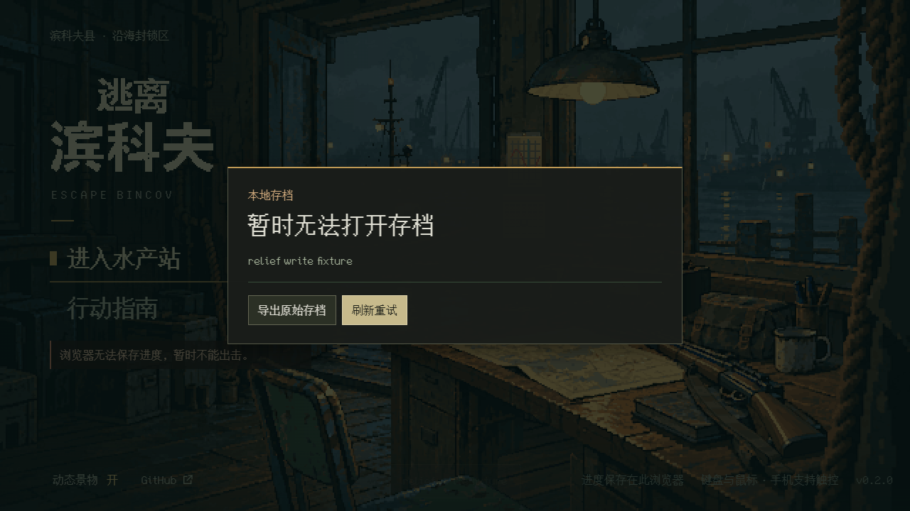
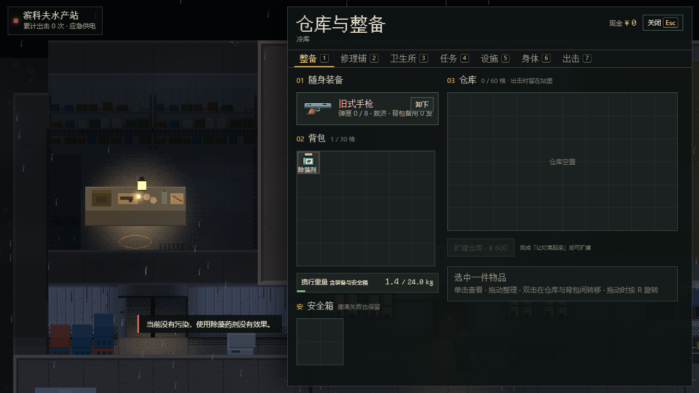

# 水产站进站救济

2026-10-11；基线 main `21e379698fea217392c553ee761c8079ac9e42af`，分支 `fix/station-relief-entry`。对应 [Issue #32](https://github.com/xuys2025/escape-bincov/issues/32) 的 ASTRA-STATION-RELIEF-01，以及 #35 留下的一处药剂名称。#35 已合并且 main CI 通过，本次是独立的小项修复。

## 玩家可见变化

符合原规则的玩家在进站时就保存救济，不再等院子画面加载完成后补发。保存失败留在入口，使用现有导出/刷新提示；恢复写入后再进站只领到一份。现金门槛、已有武器判定、救济标记和发放数量均沿用原规则。背包与仓库放不下时继续保留未领取队列，腾出空间后只补剩余数量。

补给拒绝提示中的“解毒剂”改为现有物品名“除藻药剂”。没有改药效、图片或界面布局。

## 实现与存档兼容

- `HideoutRuntime.enter()` 负责进站救济；画面创建/重挂不再调用 `claimRelief()`。
- `SaveSession.grantReliefResult()` 区分已提交、无需发放、写入被阻止、保存失败。旧 `grantRelief()` 布尔约定保留，旧页签仍使用原入口。
- 新档/旧档升级仍由 `ensureRpg()` 完成。升级和随后救济是**各自原子提交的两个步骤**：救济失败不会撤销已成功的成长系统升级，也不会把救济留在内存假装成功。已有未提交训练先保存，避免救济推进版本时丢失有效训练秒数。
- 不改存档格式、存档键、交易或回站结算；活动行动和多窗口写入保护保留。所有资产仍内嵌，两份 HTML 字节相同。

## 验证

Windows、Node 24.19.0、pnpm 11.19.0、Chrome 154.0.8037.99。以下浏览器检查使用实际单文件构建、真实 Runtime/SaveSession 和鼠标点击；贫困库存与配额失败由显式 `?test=1` 夹具准备，固定 Date 时钟仅隔离库存写入。不是实际玩家存档或真机验收。

| 检查 | 结果 |
| --- | --- |
| `pnpm test` | 292/292；新增5项覆盖无画面进站、满包剩余队列、失败重试、资格/冲突/行动锁、训练保存 |
| 新单测在改动前源码上 | 1/5，4项预期失败；原失败日志保留 |
| `pnpm package` | 通过；发布包与 manifest 由源码生成 |
| `pnpm test:station-relief` | 6/6；1280×720、1920×1080；0页面错误、0外部请求 |
| 同脚本跑 main 原 HTML | 1/6；只有原页签兼容项通过，其他5项检出旧问题；[原始结果](evidence/baseline-browser.json) |
| `test:hideout` / `test:save-browser` | 8/8、9/9，含故障注入、重试、旧入口与多窗口保护 |
| `test:station` | 76/76；真实训练、出击回站、手机布局及生命周期，0页面错误/外部请求 |
| `test:portable` | 通过，实际解压后的离线入口与恢复 |

新检查加入 CI 的 world 组；准确提交的完整 CI 状态以承接 PR 为准。完整本地回归结果及构建哈希见 [verification.json](evidence/verification.json)，专项详细结果见 [browser.json](evidence/browser.json)。首次专项已6/6；为了让证据图中的提示完整显示，随后只给截图增加入场动画结束等待，专项再次6/6，产品字节未变。

新工作树首次离线安装失败（本地 Phaser 缓存缺失），通过本机7897代理从官方源 frozen install 成功；未改依赖版本或锁文件。本地原始日志保留在忽略的 `test-results/relief/`，只提升必要证据到本目录。

## 实景

进站： [1280×720](evidence/entry-1280x720.png)、[1920×1080](evidence/entry-1920x1080.png)。

保存失败停在原入口：

药剂名称：

## 边界

真机、真人、长期内存本轮未测。历史 F20/PARTIAL、ASTRA-SAVE-01/UNCONFIRMED、人物素材、商店后续接口及其他 #32 项均保留。未合并、未手动发布或更新试玩站。
