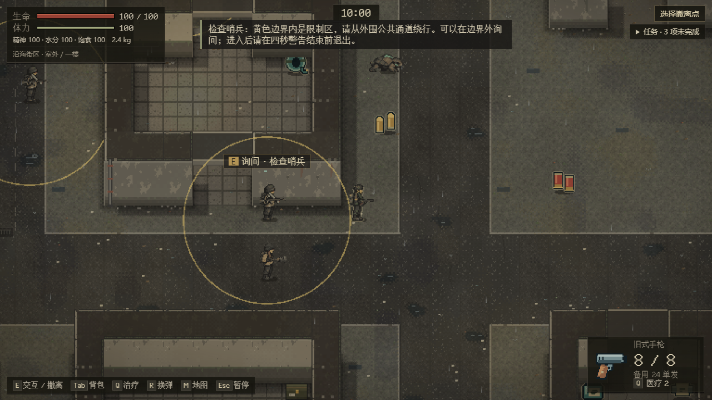
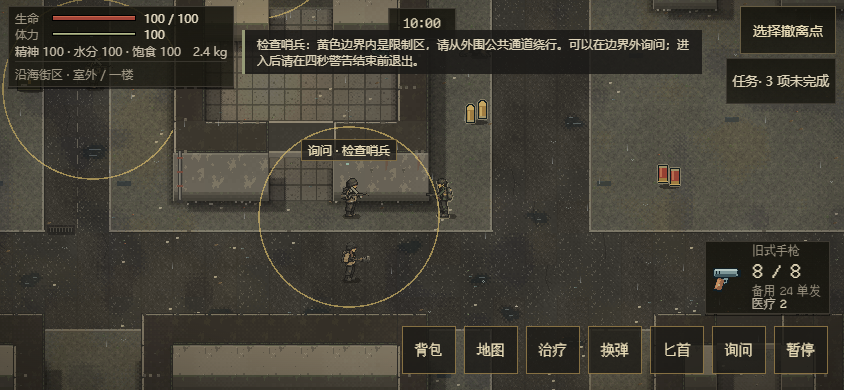

# 敌人组织与立场：已接入的规则和验证边界

承接 [#78](https://github.com/xuys2025/escape-bincov/issues/78) 的 EN-10～12，继续 [PR #81](https://github.com/xuys2025/escape-bincov/pull/81)。普通新街区仍只放三名拾荒者；以下跨势力、交涉与兵种组合由合法存档和纯规则场景验证，尚未替代完整检查站、回收点、正式地图与美术验收。

## 目标、碰撞与归属

[enemy-relations.ts](../../src/enemy-relations.ts) 是关系规则唯一入口：拾荒者与雇佣兵/封锁队互为敌对，雇佣兵与封锁队彼此中立，同组织人类友好。动物按自身领地行动，失控盐蚀者不接受执仪者语言命令。报告必须同组织、同编组、在通信距离内；不会把动物或所有分类成员组成一个共同阵营。

控制器只选择本层实际可见目标，优先当前接敌对象，再比较明确敌人和距离。目标丢失后保留最后观察点；不能因为附近另有普通玩家，就把对 NPC 的敌对转嫁给玩家。无视线的最后位置只用于搜索，不能授权向该点持续射击。三类街区职责的完整观察/攻击规则仍见[样板记录](enemy-street-encounter.md)。

新 NPC 弹丸与挥击按最近身体/实体遮挡结算：友方身体和旧四类敌人拦截但不受该 NPC 的伤害；中立新原型可能被误伤，并记住实际攻击者作自卫。玩家攻击仍可伤害新原型并触发其自卫。旧活动行动及旧四类发射行为保持原合同，尚未将旧敌人追溯赋予新阵营。

`damageLayerEnemy` 接收攻击者 UID 和本次攻击来源点；它拥有伤害、尸体及玩家训练/击杀归属。NPC 互殴只设置 `tactics.killedBy`，不增加 `raid.kills` 或玩家训练。`raid.kills` 的严格校验按玩家归属统计；死亡事件中的可选 `killer` 同步制止错误的玩家击杀标记。旧事件不加字段，以保留旧世界 A/B。弹药和携带物仍与尸体同源，重复伤害不生成第二份掉落。

## 楼梯与询问

只有近身掠夺者、突击兵可跨层跟随。必须当前可见、最近一秒亲眼观察玩家、已经接敌且攻击阶段为空闲；望风者、岗哨、头目及动物留守。最多两个新原型同时处于追击事件，不创建援军。可达路线、开门、连接等待、落点占用、涨潮改路与 UID 移交沿用既有事务，进入楼梯提示随成功事务发布。抵达后清掉原层观察点，保留弹药、生命、通报锁，再从新层重新观察。

条件敌对目标可在 156 像素内、同层且身体通路无阻挡时询问；限制圈半径 90 像素，四秒警告后才升级。这个距离允许玩家在边界外取得反馈。显示提示、触摸按钮与实际动作共用同一目标筛选，旧地图引用、超距或被遮挡引用不能执行。询问只显示外围绕行规则，不写存档，不清除警告，不提供临时无敌或跨刷新豁免；正式通行资格与任务仍等待具体检查站场景。

## 验证

- [enemy-relations.test.ts](../../tests/enemy-relations.test.ts)：阵营和通信边界、墙/友军/旧体拦截、误伤实际攻击者、NPC 死亡零玩家收益、真实 Runtime 近战、严格档校验、原子失败/重试及边界外询问。
- [enemy-pursuit.test.ts](../../tests/enemy-pursuit.test.ts)：亲眼目击、攻击锁、岗位限制、两人预算、身份移交、恢复及跨层坐标清除；旧 `pursuit.test.ts` 仍运行。
- `test:enemy`：在两种桌面尺寸及游戏支持的 844×390 横屏触摸模式检查边界、询问和动作。首次加入 390×844 竖屏时被游戏原有转屏暂停规则阻止，测试调整为正式支持的横屏，未绕过旋转限制。

这些检查不代表真手机、原生 GPU 或真人平衡通过。完整小队掩护/岗位、组织场景、通行任务、十八类正式素材和十二规划区域仍保持开放。

本批本地实跑：593/593 单测、53/53 CI 规则、`pnpm package`、最终离线 HTML 的 `test:enemy` 九场景通过，零页面错误/外部请求。固定旧世界 `76adbd6` 对照 9/9 行为与末态哈希相同，两遍共 18 次均可恢复。合法 NPC 击杀样本交给两个固定历史客户端，40 项拒绝/零写入/原字节保留通过。

新街区自然游玩 2026-10-23 13:03:56～13:14:10 UTC（约 10 分 14 秒）通过，两次行动均撤离，零页面错误/外部请求；观测到新枪手与望风者前摇。它运行的是本批 AI 构建，随后仅补死亡事件 `killer` 和 HUD 标记过滤；最终事件由单测、最终打包与浏览器场景覆盖。日志及完整 JSON 在本地 `test-results/enemy-factions-*`，远端 CI 以 PR 的准确提交为准。

