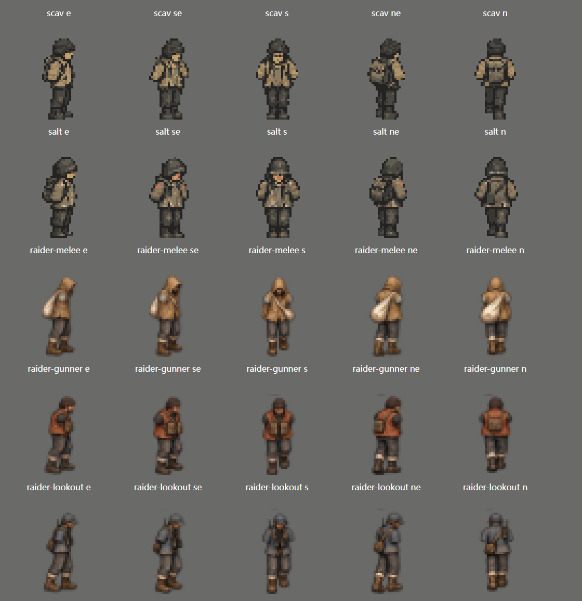
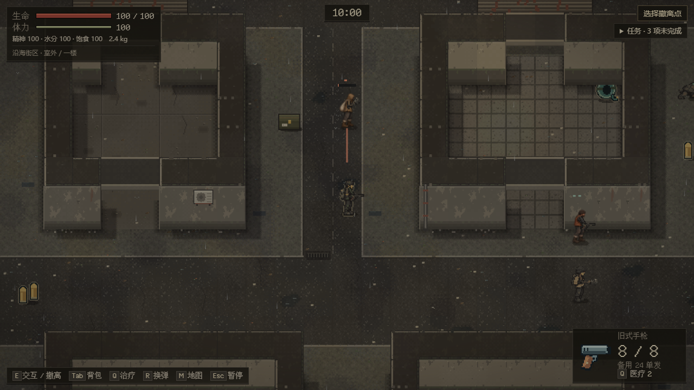
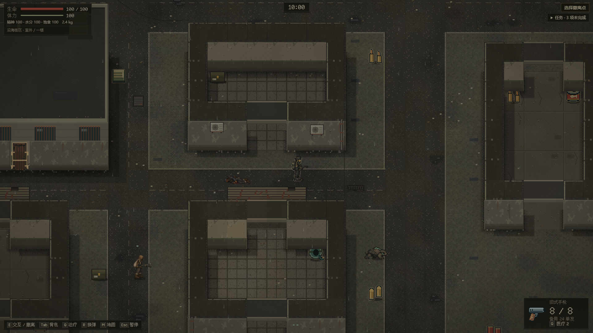

# 街区三原型：角色素材与接入

承接 #78 EN-09 / EN-18，继续 [PR #81](https://github.com/xuys2025/escape-bincov/pull/81)。仅三类街区角色有本批素材；其余十五类及十八原型整体验收保持开放。

| 原型 | 身体辨识 | 运行帧 |
| --- | --- | --- |
| 近身掠夺者 | 沙色兜帽、偏瘦身体、白色斜挎编织袋 | E/SE/S/NE/N × idle+4步态，尸体1张 |
| 拾荒枪手 | 宽肩锈橙背心、黑帽、胸前弹袋 | 同上 |
| 望风者 | 短蓝灰上衣、贴身小包、望远镜和对讲机天线 | 同上 |

共 78 张 PNG，身体 32×48、脚点 `(16,48)`，尸体 48×32、中心 `(24,16)`。身体不带手部/武器；Runtime 继续绘制关节手臂、持握、前摇/换弹/恢复与倒地过渡。不是额外生成完整攻击动画帧；当前攻击动作的阅读仍依靠真实阶段投影、持握和提示。新角色受击闪白、遮挡轮廓和尸体均从对应原型贴图派生，不能退回旧身体。

## 来源与可复现导出

使用内置 `image_gen` 生成原始图，未下载第三方角色图、未调用 API/CLI 替代。最终提示词及一次透明边缘修订保存在 [prompts-v1.json](../../assets/enemies/sources/prompts-v1.json)，六张选用原图在同目录。PNG 的非透明部分与透明通道保留；预览显示的棕色 RGB 不代表实际不透明背景。

[enemy-export-art.mjs](../../scripts/enemy-export-art.mjs) 仅按固定 5×5 网格切帧、统一缩放与脚点、导出运行尺寸；不重绘素材。身体全部 25 帧共享一个坐标变换，避免逐帧居中造成滑步。尸体独立居中适配。`assets/coast/enemy-v1/` 是实际运行图，原始大图不会内嵌游戏。

[素材清单](../../assets/enemies/manifest.json) 记录来源、SHA-256、尺寸和锚点；构建核对源图、帧图、总导入清单与哈希。新角色只有存在对应素材时才选该外观；旧四类、旧档以及显式占位模式保持原选择。所有实际 PNG 由打包器内嵌，普通游玩无外部请求。

## 当前证据

`test:enemy` 覆盖两种桌面尺寸的三原型前摇/尸体，枪手换弹/恢复、交涉，以及 844×390 横屏触摸的三原型与交涉。测试从严格解码通过的真实保存状态进入离线 HTML，断言实际绘制纹理和原型一致，记录浏览器错误及网络请求。新增测试初次使用枪手参数构造近战样本，被存档校验拒绝；现按原型的弹药与前摇上限构造，未放宽解码器。

22 个敌人浏览器场景通过，零页面错误/外部请求；599 单测、53 CI 规则、正式流程 `test:browser`、两尺寸 `test:ui` 和 `test:portable` 均通过。已检查整数倍对照图、1280×720 前摇、1920×1080 尸体实景和横屏触摸截图。真手机、原生 GPU 和真人平衡未验。

同一最终 HTML（SHA-256 `acec21fe0d82c654e3bce99fdc7af4a733512fe2d73d1d355bf0a2f1ecc63aeb`）于 2026-10-23 13:47:10～13:57:14 UTC 完成 10 分 4 秒新街区实际输入游玩：前摇、恢复与枪手换弹均有观测，零页面错误/外部请求。脚本在低生命情况下也继续出击，包含多次短撤离与死亡，不能据此证明数值平衡；完整 JSON 留在 `test-results/enemy-art-natural-play.json`。旧世界固定输入 9/9 A/B 与 `76adbd6` 相同。本批制品 HTML 5,973,711 字节、便携 ZIP 3,761,720 字节。

