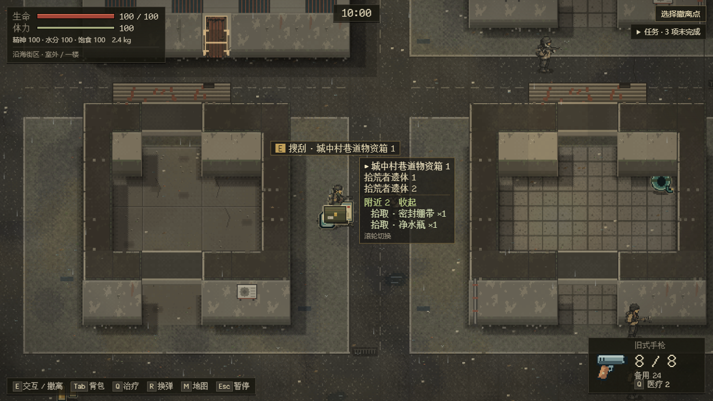
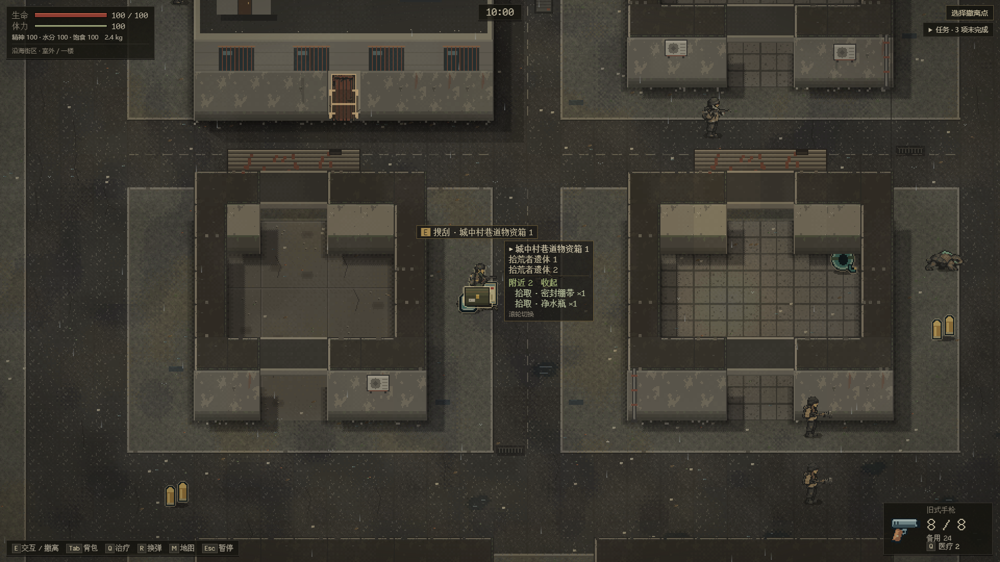

# Runtime 收尾接口与存档复验

2026-10-17，Astra；分支 `agent/runtime-gaps`。起点为 PR #64 的 `92a0b237b18b2aea36f7c9bfbdb67b0b34346748`，已接受 main 为 `1764874`。本 PR 目标 main，依赖 #64（已合并为 `345aff4`）。Runtime 提交 `07d3efc` 未修改 Opus 的测试时序加固、宿主、地图、美术或存档格式；宿主接入由 Opus 在 `a678142` 完成，见 [Opus 接入](#opus-接入)。2026-10-22 同步 main 与收尾验证见[收尾与同步](#收尾与同步)。

## 固定 head 复验

先在独立 detached 工作树上复验上述 #64 head，未改生产代码；[完整评论](https://github.com/xuys2025/escape-bincov/pull/64#issuecomment-6227000538)。452/452 单测、raid-default 9/9、save-browser 9/9 通过。五条恢复路径的独立探针通过后保存在 [runtime-closeout.test.ts](../../tests/runtime-closeout.test.ts)：coast-v2、coast-v1 迁移、商场 1/2/3，各自暂停/继续、实时备份、四结局失败候选、单次重试、跨会话冲突与可导出备份。

`magazine/vitals/clock/spawnLoot/container/hurt` 均实际运行，捕获的完整记录经 `decodeSession` 严格校验。原工厂 opt-in 单测和普通入口浏览器检查共同覆盖 `?test=1` 门禁。未放宽校验器或把非法输入当可用存档。

环境伤害截零正确：旧世界的流血/污染与 `applyDamage`、分层环境伤害、换层弹道一致；`enemyDamage` 的扣除量不超过剩余生命。没有发现有效游戏路径把负生命写入身体。原流血致死用例和本分支补充的污染/分层致死用例均覆盖成功结算与不重复写入。

## 本次实现

接口的参数与失败契约以 [contract.ts](../../src/raid-runtime/contract.ts)、[runtime.ts](../../src/raid-runtime/runtime.ts) 的源码旁说明为准；回归在 [runtime-gaps.test.ts](../../tests/runtime-gaps.test.ts)。

- **治疗拒绝**：`transaction` 在药品操作返回 rejected 时将该操作的说明放进 `rejected.reason`，仅保留说明，不发布被回滚的成功事件。保存失败仍为 `save-failed`。分层补给使用已有 `useRpgItemResult`，满血无流血有明确中文原因。现有宿主支持中文 reason，未改宿主就能显示原话；desktop-input/mobile/ui-review 三处已恢复 `/生命已满/` 断言。
- **逐件地面拾取**：`services.activate({runId,mapId,kind:'ground',id:uid})` 不受 E 当前优先箱子影响，仍用 `nearbyLoot()` 的 `<43` 距离、视线/通行和潮汐规则。保留 run/map 与暂停/面板/冲突守卫。同一 `SaveSession.mutate` 提交背包和世界；写失败全回滚。`retrySave` 恢复保存能力，不会自动重做拾取，调用方需再发起；成功后同一 UID 不能再领。测试涵盖重叠箱子、过期引用、满包/部分拾取、一次写入和回滚。
- **门失败原因**：不可达为 `rejected{action:'door',reason:'unreachable'}`，门口占用为 `occupied`；不再把这两种情况合为 `unreachable-or-rejected`。楼层入口旧拒绝码暂不改。失败不写存档、不发 door 成功事件；现有写失败重试测试继续保留。
- **重对时**：生产端口增加 `runtime.resetClock()`。宿主须在挂载的首次实际绘制/贴图烘焙完成之后，以及换层重建/首次绘制完成之后调用一次，再进入正常逐帧 advance。它只丢弃下一次 wall-clock 间隔，不走时、不写入、不解除暂停、不改变 epoch/RNG/输入，也不解除时间戳单调性检查。不能每帧调用；真实 >2 秒卡顿仍须暂停。如果烘焙分散在多帧，宿主应先完成明确的准备阶段再重对时，不能只在异步 mount 开始时调用。

## 死亡后 1 血

这是已有明确设计，见 [RPG 设计](../RPG-SYSTEM-DESIGN.md)“基地恢复”与 `SaveSession.prepareSettlement`：新版分层行动死亡后生命 1、耐力 0、精神 20、水分/饱食 40、污染 50 返站，原 debuff 由基地治疗；出击按钮不自动补满。单测固定了同一时间立即再出击仍为 1 血。旧封锁区保留旧行动规则，死亡可留 0，本次不统一或调整数值。是否需要返站提示或降低再次出击的挫败感，应另作产品决定。

## 验证与边界

以下为 Runtime 阶段（2026-10-17，`07d3efc`）的结果。本地 Windows，先用系统 Node 22.22.2 验证，再用内置 Node 24.19.0 补验完整单测及 package；两次均通过且 HTML 哈希相同。pnpm 11.25.0、Chrome 155.0.8059.80；pnpm 与仓库 CI 的 11.19.0 有版本差异，不能把本地结果冒充 CI。浏览器由系统 Node 启动，为离线自动化；桌面两尺寸 1280×720、1920×1080，移动尺寸按各套件。

当时 `pnpm test` 468/468（新增 16 项），`pnpm package` 通过。desktop-input 10 项、mobile 11 项、ui 38 个检查点、save-browser 9 项以及 loot-target、mobile-ux 均已通过。后两套当时保留原前端缺口守卫，`a678142` 接入附近列表后改为正式验收。日志保留于本地忽略目录和 `*.log`；构建制品及 SHA-256 见 [release-manifest](../release-manifest.json)。没有真机、无 GPU 慢设备端到端、真人平衡性或十分钟真实计时的结果；慢帧方案当时只验 Runtime 时钟契约，宿主接入见下文。未宣称 #64 红 CI 已修复或全 36 套已通过。

## Opus 接入

`a678142` 完成以下四项，`1875890` 重新打包；验证见 PR 正文和下文[收尾与同步](#收尾与同步)。

1. 「附近」逐件列表：E 指向容器，或指向散落物且范围内有两件以上时，来源列表多一行「附近 n」，展开后每件一行；桌面点击、触屏轻点都经 `activate({kind:'ground'})` 拾取该件，E 仍打开选中的容器，最后一件拿走后这一行消失（[搜刮说明](../LOOTING.md)）。列表数据是 `Interaction.nearby`，与 `nearbyLoot` 同一距离、视线和潮汐规则。loot-target、mobile-ux 的旧缺口守卫已改为正式验收。
2. 门提示：`occupied` 显示“门口有人，暂时不能关门。”；`unreachable` 与旧画面一样不提示；楼层入口被拒仍显示“入口被挡住”。
3. 重对时：宿主在挂载和换层重建后置位，下一帧 `advance()` 之前调用一次 `resetClock()`，首次烘焙和贴图上传的耗时不再触发卡顿暂停；之后的正常帧不重置，超过 2 秒的真实卡顿仍暂停。
4. 治疗被拒的中文 reason 由宿主直接显示，desktop-input、mobile、ui-review 三处“生命已满”断言保留。

商场布局四版注册/并存与新沿海封锁区地图数据没有开工。

## 收尾与同步

2026-10-22，按维护者要求由本机 Claude Code 收尾。先后两次把 main 合并进本分支：`a4f463a`（含 #66–#72）与 `c6ad042`（含 #74 的 CI 改动），保留原历史，不改写。冲突只在生成物和两份记录（任务清单、handoff）：生成物由 `pnpm package` 重新生成，记录两边都保留。#72 的路由收敛（`src/navigation.ts`、`src/pixi-app.ts`）与本分支对 `src/coast-view/host.ts` 的改动没有文本冲突。

收尾时补了两处：

- **E 提示不再被列表压住**：截图检查发现，「附近」展开后来源列表变高，而列表以目标为中心上下居中，顶边会升进 E 提示，盖住提示右端（1280×720 约 20 px，手机横屏约 28×22 px，量过的七种尺寸都有）。现在列表不动，提示抬到列表顶边之上；抬起后会出屏幕顶边或碰到状态卡时保持原位。没有改为下移列表，因为在 640×300、740×300 上列表下移会压到触屏按钮。来源很多时以前也会这样遮挡，这次一并修好。
- **门被占提示有了回归检查**：buildings 套件新增一步，玩家站在开着的门洞里按 E，要求出现“门口有人，暂时不能关门。”，且门在运行状态和已存记录里都保持开着。此前只有 Runtime 单测覆盖 `occupied` 原因码，宿主显示的文字只在本地探针里查过。

截图来自离线构建：种子 42，箱子上放倒两名拾荒者，旁边两件地面物资，展开「附近」。

本地验证（Windows 10、Node 24.22.1、pnpm 11.19.0、本机 Chrome；桌面套件含 1280×720 与 1920×1080）。浏览器检查在修复后的构建上运行，合并 `c6ad042` 后构建逐字节不变：

| 检查 | 结果 |
| --- | --- |
| `pnpm test` | 479/479 通过 |
| `pnpm package`（含 `tsc --noEmit`） | 通过；合并后重新打包，生成物与已提交的一致，哈希见 [release-manifest](../release-manifest.json) |
| `scripts/ci` 守卫 | 51/52。唯一失败是 policy 的 shell 门禁用例写死了 Git for Windows 的默认安装路径，本机 Git 装在用户目录，属环境问题；CI 照常运行该用例 |
| loot-target、mobile-ux、mobile、desktop-input、ui、buildings、qol-expansion、mall-sample、issue26-spatial、issue26-inventory、loot、save-browser、raid-default | 13 套全部通过（raid-default 9/9、mall-sample 22/22）；issue26-spatial 只报已登记的楼梯名缺口 |
| coast-sample | 52/53，只有 W13 失败；main 上同样失败，是测试时序问题，登记在 [#61](https://github.com/xuys2025/escape-bincov/issues/61#issuecomment-6338851506) |
| 提示与列表几何 | 1280×720、1920×1080 与 640×300、667×375、740×300、844×390、932×430 触屏共七种尺寸：展开「附近」后提示与列表不重叠；列表位置与修复前相同，两者都不压其他可见 HUD |

CI 结果以 PR #65 页面为准。存档格式未改。未验：真机与 Safari、无 GPU 慢设备的完整流程、真人平衡性、十分钟自然游玩。300 px 高的横屏上，列表仍受原有最大高度限制，来源较多时展开后的最后一行要在列表内滑动。#60 的 Q-E02 B 段（行动句柄合同、背包有限服务）与本 PR 改同一批文件，本 PR 合入后即可开工。
